# 神经元工作流平台 · 万象台 — 项目仪表盘

> ⚠️ 本文件由 pm-mcp 自动生成（勿手改）。状态账本写入后自动刷新；手动刷新用 regenerate_dashboard。
> 生成时间: 2026-11-06T18:57:31.383Z
> 神经元式智能体工作流可视化平台：以"赛博蜘蛛 HUD + 道家哲学叙事"为设计语言的单文件交互原型，持续迭代至电影级观感

## 🗺️ 路线图

```mermaid
flowchart LR
  M30["M30 v2.8 修复与加固：前后端接线 + 安全 + 持久化 + 测试可信"]:::done
  M31["M31 生产化 P0–P2：版本控制 + 安全加固 + 后端可靠性（关口A）"]:::active
  M32["M32 生产化 P3–P5：核心能力 + 前端工程化 + 测试体系"]:::planned
  M33["M33 生产化 P6–P7：部署运维 + 收尾（v3.0.0）"]:::planned
  M27["M27 后端服务 · AIGENT-WORKFLOW STUDIO v2.8 FastAPI"]:::done
  M28["M28 终极版 · 动态拓扑后端 + React 工作台（1:1）"]:::done
  M29["M29 万象台 · 动效引擎 1:1（动画效果.txt 权威落地）"]:::done
  M30 --> M31
  M31 --> M32
  M32 --> M33
  M33 --> M27
  M27 --> M28
  M28 --> M29
  classDef done fill:#9ca3af,stroke:#6b7280
  classDef active fill:#86efac,stroke:#16a34a
  classDef planned fill:#e5e7eb,stroke:#9ca3af
  classDef paused fill:#fde68a,stroke:#d97706
```

✅ [██████████] 100% M30 v2.8 修复与加固：前后端接线 + 安全 + 持久化 + 测试可信（1/1）
▶ [██████████] 100% M31 生产化 P0–P2：版本控制 + 安全加固 + 后端可靠性（关口A）（2/2）
○ [░░░░░░░░░░] 0% M32 生产化 P3–P5：核心能力 + 前端工程化 + 测试体系（0/3）
○ [░░░░░░░░░░] 0% M33 生产化 P6–P7：部署运维 + 收尾（v3.0.0）（0/2）
✅ [██████████] 100% M27 后端服务 · AIGENT-WORKFLOW STUDIO v2.8 FastAPI（1/1）
✅ [██████████] 100% M28 终极版 · 动态拓扑后端 + React 工作台（1:1）（1/1）
✅ [██████████] 100% M29 万象台 · 动效引擎 1:1（动画效果.txt 权威落地）（1/1）

## 🎯 当前焦点
- （无进行中任务。从 backlog 挑一个开始，或 add_task 创建。）

## 🩺 健康摘要
| 账本 | 状态 |
|---|---|
| 漂移（防幻觉） | ⚠️ 124 项（功能入口文件或 done 任务关联文件缺失） |
| 债务（反挤出） | ✅ 无未清债务 |
| churn（变更率） | ⚠️ 热点 neuron-workflow-v15.html(71), test/verify-v15.js(71), package.json(19) |
| 安全 | ✅ 无未处理发现 |
| 调试知识 | 5 条记录 |
| 测试背书 | 57/58 个功能带测试 |
| 语义治理 | 0 模块 / 0 接口 / 0 仓库 |
| 质量矩阵 | ✅ 2026-11-06 18:57（命令 2/2；证据 execution_only） |
| 标准化验收 | ⚠️ 尚无正式评价报告 |
| 自动编排 | — disabled（自动编排已关闭（set_orchestrator））· 并发 3 · 轮次 0/40 |

## 🧭 模块与语言治理
- ⚠️ 尚未登记结构化模块；文件级账本可用，但依赖/owner/接口边界尚未启用。

## 📋 任务
- 总览: done 77 · cancelled 2 · backlog 5

## 🧩 功能清单
### 总控HUD
- ⚠️ 漂移 F-001 万象台 v15 电影级中文 HUD — 
### 可视化原型
- ⚠️ 漂移 F-002 v35 星河 · 银河旋臂 — 星云片元着色器新增极坐标对数螺旋银河带；修复 v33 引入的 col 声明顺序 bug；版本号统一为 VERSION 单一来源。
- ⚠️ 漂移 F-003 v36 天梯 · 道果成就阶梯 — 道果成就阶梯：500 任务/重十二重解锁，金色天梯 UI+攀登进度线，localStorage 传世。
- ⚠️ 漂移 F-004 v37 月相 · 月轮 — 朔望月算法真实月相，暗影滑移月盘+八相月名。
- ⚠️ 漂移 F-005 v38 惊蛰 · 天雷 — 分叉落雷：主通道+侧枝、雷声白闪涟漪、随机调度。
- ⚠️ 漂移 F-006 v39 灵雨 · 三维雨帘 — 符文雨三维化：深度、雨丝拖尾、落地溅漪。
- ⚠️ 漂移 F-007 v40 潮汐 · 月引潮力 — 月相驱动潮汐系数，粒子球体向月微隆，潮汐表。
- ⚠️ 漂移 F-008 v41 星轨 · 长曝星迹 — 离屏画布长曝星迹：二十八宿轨迹累积+慢衰减。
- ⚠️ 漂移 F-009 v42 太虚 · 镜界反转 — 按 X 镜界反转：反色滤镜+调色板互换+星云反 tint+旋转倒转。
- ⚠️ 漂移 F-010 v43 虫洞 · 曲径传送 — 双击开启虫洞：旋涡卷入粒子，2.4s 闭合。
- ⚠️ 漂移 F-011 v44 星语 · 连星成座 — L 连星模式：点选星官成座、命名入史册、随穹长驻。
- ⚠️ 漂移 F-012 v45 罗盘 · 风水辨凶 — 八卦环罗盘，红针实时指向失衡智能体方位。
- ⚠️ 漂移 F-013 v46 时轮 · 回溯 — 按住 K 时间放缓，60 秒事件刻度环。
- ⚠️ 漂移 F-014 v47 丹炉 · 炼丹术 — 按 B 炼丹，三味真火+丹成真实增益。
- ⚠️ 漂移 F-015 v48 河洛 · 洛书方阵 — 洛书 3×3 方阵，九格绑定智能体负载。
- ⚠️ 漂移 F-016 v49 卦象 · 蓍占 — 按 I 系统熵起卦，六爻+六十四卦+断辞。
- ⚠️ 漂移 F-017 v50 五十 · 大成庆典 — 五十章大成金印+章名滚动幕，每会话一次。
- ⚠️ 漂移 F-018 v51 灵兽 · 图腾觉醒 — 八灵兽图腾，连中四元觉醒兽印。
- ⚠️ 漂移 F-019 v52 山水 · 千里江山 — 程序化青绿山水三层，随运镜视差。
- ⚠️ 漂移 F-020 v53 篆韵 · 印玺变体 — 章节巨字红底白文朱印变体+常驻朱砂小印。
- ⚠️ 漂移 F-021 v54 晨钟 · 暮鼓报时 — 真实整点报时：晨钟三重金环，暮时鼓声。
- ⚠️ 漂移 F-022 v55 香火 · 青烟 — 情绪驱动心烟从天眼升起卷曲上飘。
- ⚠️ 漂移 F-023 v56 墨池 · 滴墨 — 失败滴墨入穹底污渍，缓慢洗散。
- ⚠️ 漂移 F-024 v57 千机 · 机关锁主题 — 方向键六连解千机锁，开启天工铜金主题。
- ⚠️ 漂移 F-025 v58 星市 · 天市悬牌 — 智能体头顶浮动灵价签。
- ⚠️ 漂移 F-026 v59 天平 · 秤心衡器 — 天平横梁实时称量成败比，物理倾斜。
- ⚠️ 漂移 F-027 v60 甲子 · 轮回刻环 — 六十甲子轮回刻环，当前干支金亮。
- ⚠️ 漂移 F-028 v61 紫微 · 十二宫盘 — 十二宫环映射智能体，宫亮随活跃度。
- ⚠️ 漂移 F-029 v62 灵犀 · 通感映射 — 音效开启时频谱均值驱动穹顶呼吸与增亮。
- ⚠️ 漂移 F-030 v63 织女 · 天梭曼陀罗 — 金线自动织入智能体间，天梭光点飞行。
- ⚠️ 漂移 F-031 v64 海市 · 蜃楼天际线 — 穹平线蜃楼群影，正弦摇曳。
- ⚠️ 漂移 F-032 v65 脉冲星 · 灯塔射电 — 双灯塔射电束旋转扫掠，扫中滴答+闪光。
- ⚠️ 漂移 F-033 v66 云海 · 翻云层 — 云团横渡穹顶，三重软圆叠层。
- ⚠️ 漂移 F-034 v67 流萤 · 集群趋向 — 流萤群体弱引力 flock 向最忙智能体。
- ⚠️ 漂移 F-035 v68 棋枰 · 手谈 — 九路棋枰，编排功成落黑子、失败落白子。
- ⚠️ 漂移 F-036 v69 展卷 · 全景平移 — []键整台横向平移，复合全息倾角变换。
- ⚠️ 漂移 F-037 v70 七十 · 古稀卷轴 — 古稀横卷展开：轴杆+绢帛+四十式时间线，N 键重演。
- ⚠️ 漂移 F-038 v71 天工 · 锻造台 — 高活跃智能体自动锻造，成器入史册。
- ⚠️ 漂移 F-039 v72 圭表 · 日影钟 — 真实太阳时角驱动圭表日影，正午金亮。
- ⚠️ 漂移 F-040 v73 占星 · 星曜相位 — 轨道角对齐自动连相位线：合相金线、冲相赤线。
- ⚠️ 漂移 F-041 v74 灵脉 · 地脉光纹 — 三条地脉弧线，亮度随吞吐与真算力脉动。
- ⚠️ 漂移 F-042 v75 凤鸣 · 涅槃重生 — 累计 5 次失败凤凰浴火重生，火羽上弧+情绪清零。
- ⚠️ 漂移 F-043 v76 戴森 · 采集星环 — 六座采集器环穹运转，光束采撷令牌。
- ⚠️ 漂移 F-044 v77 万象归一 · 主场景编排 — 按 Q 编配全系统联袂演出 40 秒。
- ⚠️ 漂移 F-045 v78 编钟 · 五音键盘 — 八键弹奏编钟，五声音阶+章节移调。
- ⚠️ 漂移 F-046 v79 湮灭 · 正反物质 — 稀有湮灭事件：正反粒子汇聚+γ闪+冲击环。
- ⚠️ 漂移 F-047 v80 八十 · 长明火 — 穹右下长明火长燃不熄，火苗随真算力旺衰。
- ⚠️ 漂移 F-048 v81 御风 · 全球风场 — 全局风场相干驱动雨/烟/流萤/云。
- ⚠️ 漂移 F-049 v82 天命 · 玺诏颁行 — 周期颁玺诏：绢帛诏书+朱印+敕文打字机。
- ⚠️ 漂移 F-050 v83 无极 · 太一终形 — 按 E 万象归一：粒子坍缩太一奇点。
- ⚠️ 漂移 F-051 v84 封神 · 万象终章 — H 键封神终幕：终金印+八卷章名+金环，五十版大满贯收官。
- ⚠️ 漂移 F-052 神经智能体工作流平台 · 仿图复刻 — 仿参考图复刻的神经智能体工作流平台：神经元背景+组件树+工作流图+雷达/JSON/日志三面板，agent-flow-platform.html。
- ⚠️ 漂移 F-053 AIGENT-WORKFLOW STUDIO v2.8 · 完整还原 — AIGENT-WORKFLOW STUDIO v2.8 完整还原：五层布局+六组组件库（可拖拽）+五核心节点+三层发光神经突触连线+神经元动效+雷达/JSON/
- ○ F-054 神经智能体工作流平台 · 仿图复刻 — 第一版仿图，已按用户要求删除，由 AIGENT-WORKFLOW STUDIO v2.8 取代。
- ✅ F-058 动效引擎 1:1（生物发光神经元/微组件/WebGL/小地图/声效） — 按《动画效果.txt》模板 1:1 落地的前端动效引擎：BioluminescentCanvas 加色混合神经元画布、NodeMicroWidgets 四微组件
### backend
- ✅ F-055 后端 FastAPI 服务 · 神经元 DAG 引擎与实时遥测（v2.8） — AIGENT-WORKFLOW STUDIO v2.8 后端：Pydantic v2 全量数据契约；异步神经元 DAG 调度引擎（Run/Pause/Debug
- ✅ F-056 终极版 · 动态拓扑后端 + React 工作台（1:1） — 按用户终极版文档 1:1 交付：PerfectNeuralEngine（Kahn 动态拓扑分层调度 + SQLite 时间旅行断点 + 跨节点共享记忆总线 + 
### backend + frontend
- ✅ F-057 终极版动态拓扑工作台（AIGENT-WORKFLOW STUDIO v2.8 Ultimate） — 模板 16 板块 1:1 全栈落地：12算子注册表+AST自愈校验内联进 Kahn 拓扑执行流水线的 FastAPI 后端（含时间旅行断点/突触连线 CRUD/
### backend+frontend
- ✅ F-059 v2.8 前后端接线与安全加固 — 按执行模板完成：后端算子别名归一化+数据沿边流动+真实遥测指标+单节点错误隔离+运行记录API+拓扑环检测/删除级联+AST安全清洗+设置接口守卫与SSRF校验

## 🏛️ 架构决策（最近）
- （暂无）

## 📜 最近会话
- 2026-11-06 [?] T-079 生产化 P2：后端可靠性与可观测（T20-T27）：P2 八任务全部完成：T20 healthz/readyz（免鉴权，SQLite+双循环+心跳<5s）；T21 WAL/NORMAL/busy_timeout+schema_version 显式迁移 v1→v3+写锁（T26 runs 表随 v3）；T22 obs_logging JSON 日志+X-Request-ID 中间件+SecretFilter（sk-/Bearer/X-Admin-Token/?token=+精确值兜底）；T23 /metrics Prometheus（节点/LLM/轮次直方图/WS gauge，敏感鉴权面）；T24 llm_client.py（重试退避抖动 429/5xx/超时、信号量、可配超时、degraded 徽章前后端打通）；T25 start/stop 生命周期加固（cancelling 重建+轮询等待，根治快速 lifespan 双循环全灭 flake）+503 单测；T26 runs 持久化重启不丢；T27 ECG=真实 DAG 轮延迟（归一化，前端示波器吃真实序列）。关口A：pytest 155 绿 + build 212K + verify 47:0 + 8020 实机冒烟（healthz/readyz/metrics 鉴权/安全头/JSON 日志）全过
  - 改动: backend/perfect_main.py, backend/perfect_engine.py, backend/llm_client.py, backend/metrics.py, backend/obs_logging.py, backend/models.py, backend/tests/test_health.py, backend/tests/test_sqlite_robust.py 等 19 个
- 2026-11-06 [?] T-078 生产化 P1：安全加固（T10-T16）：P1 六任务全部完成并逐任务提交：T10 全局鉴权中间件+live-app签名URL（7测）、T11 WS握手鉴权 Origin/token 4401/4403（6测）+前端buildWsUrl、T12 DNS rebinding 请求时IP固定（6测）、T13 令牌桶限流+体积/数量上限（6测）、T14 安全响应头+nginx CSP（3测）、T15 Tailwind本地化去CDN去unsafe-inline（2新增）、T16 pip-audit升级fastapi0.162/starlette1.10清零14漏洞+audit_security 9项全处置（报告 docs/security-scan.md 不入files因docs目录无测试覆盖）。关口：pytest 113绿+build OK+verify 47:0
  - 改动: backend/perfect_main.py, backend/perfect_engine.py, backend/requirements.txt, backend/requirements-dev.txt, backend/static/vendor/tailwindcss-play.js, frontend/nginx.conf, frontend/src/config.ts, frontend/src/Workbench.tsx 等 15 个
- 2026-11-06 [zcode] P0 完成：git init+.gitignore+首提（无 .db/.env）；基线 pytest 83 绿 + build 245K + verify 47:0 存 docs/baseline.txt；文档↔源码核对 49 条（47一致/2行号级漂移/0虚）存 docs/doc-drift.md。pm 任务 T-077 因纯文档不适用代码门取消，改由 git 留痕
  - 改动: .gitignore, docs/baseline.txt, docs/doc-drift.md
- 2026-11-06 [zcode] 用户拍板 2 项并标注进《生产化执行方案.md》：①同意 git init（T00 去⚠️）、②范围按默认（单租户自托管/不含 K8s·OAuth/仅 3 类真实算子）。执行者定为 flash 模型，本会话仅交接不动源码。剩余 6 个拍板点（T34/T41/T61/T63/T70/T73）由执行模型现场问。
  - 改动: 生产化执行方案.md
- 2026-11-06 [zcode] 落盘《生产化执行方案.md》（供 flash 模型逐步执行）：P0 基线核对 → P1 安全加固 → P2 可靠性 → P3 核心能力 → P4 前端工程化 → P5 测试体系 → P6 部署运维 → P7 收尾，共 45 任务；含 7 条执行铁律、8 个待用户拍板点、关口A（P2 后）。纯方案文档，未改任何源码。
  - 改动: 生产化执行方案.md

---
stack: HTML, JavaScript, Canvas 2D, 手写3D投影 · modules: 可视化原型, 总控HUD, 模拟数据引擎 · exposure: local · license: 未声明
