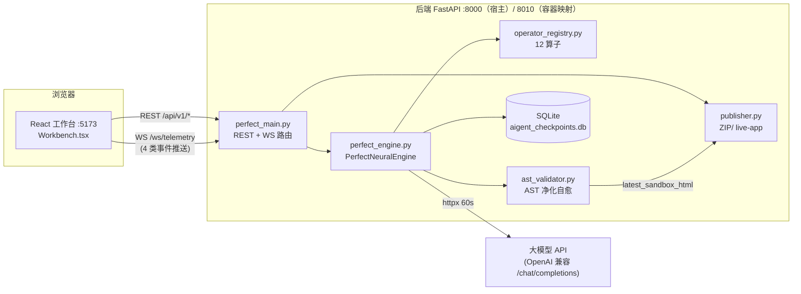
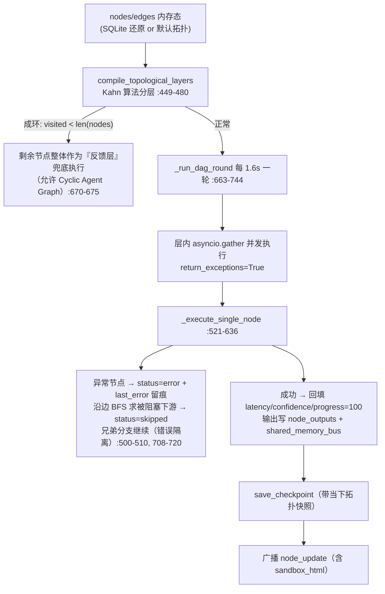
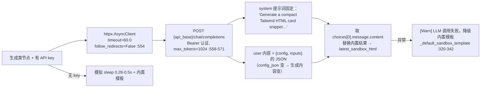
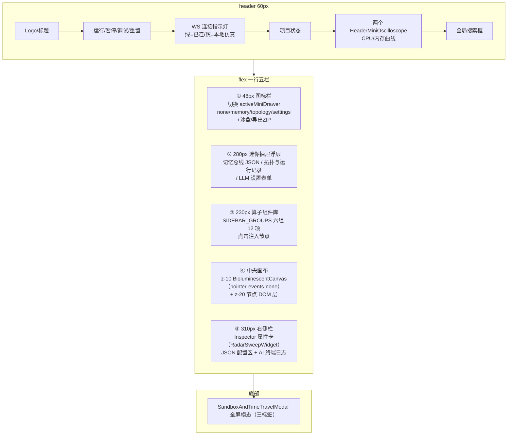
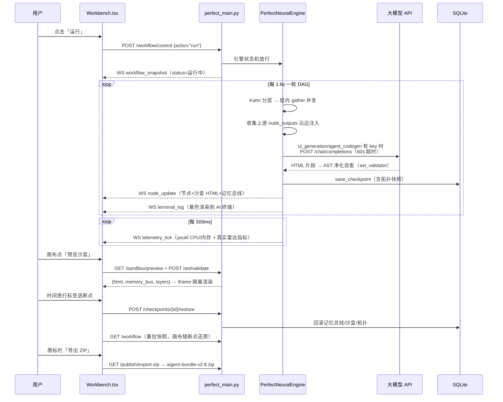

# AIGENT-WORKFLOW STUDIO v2.8 · 神经元工作流平台 — 项目源码与架构文档

> 生成日期：2026-11-07 · 对应版本：v2.8.0（backend `2.8.0-ultimate` / frontend `2.8.0`）
> 源码范围：本仓库全部有效源码（排除 `node_modules`、`.venv`、`dist`、`.pm` 运行态），约 9100 行（不含锁文件）。
> 所有论断均标注 `文件:行号`，可直接跳转核对。

---

## 目录

1. [项目概览](#1-项目概览)
2. [目录结构总览](#2-目录结构总览)
3. [系统架构总览](#3-系统架构总览)
4. [后端架构详解（backend/）](#4-后端架构详解backend)
5. [前端架构详解（frontend/）](#5-前端架构详解frontend)
6. [测试体系](#6-测试体系)
7. [部署体系](#7-部署体系)
8. [端到端数据流：一次完整运行](#8-端到端数据流一次完整运行)
9. [安全设计汇总](#9-安全设计汇总)
10. [已知边界与遗留项](#10-已知边界与遗留项)
11. [附录：快速启动 · 行数统计 · 相关文档](#11-附录)

---

## 1. 项目概览

### 1.1 定位

**神经元式智能体工作流可视化平台**：以「赛博蜘蛛 HUD + 道家哲学叙事」为设计语言的可交互 AI 工作流工作台。用户在发光的神经元画布上编排算子节点、连线成 DAG（有向无环图，兼容环路）、驱动执行引擎逐层运行，实时观察遥测（CPU/内存/雷达/心电图）、节点状态、共享记忆总线与 AI 生成的 HTML 沙盒产物，并可将产物发布导出。

### 1.2 技术栈

| 层 | 技术 | 版本 | 说明 |
|---|---|---|---|
| 前端框架 | React + TypeScript | 18.3 / 5.6 | 仅 3 个运行时依赖（react、react-dom、lucide-react），无状态管理/路由/图表库（`frontend/package.json:12-16`） |
| 构建工具 | Vite | 5.4 | `tsc && vite build`（`frontend/package.json:8`） |
| 样式 | Tailwind CSS | 3.4 | CDN + 本地构建双轨 |
| 后端框架 | FastAPI + Pydantic v2 | 0.115 / 2.9 | 单文件应用 + 单引擎模块（`backend/requirements.txt`） |
| ASGI 服务器 | uvicorn[standard] | 0.30 | `--proxy-headers` 支持 nginx 反代（`backend/Dockerfile:20`） |
| HTTP 客户端 | httpx | 0.27 | LLM 真实外呼，超时 60s（`backend/perfect_engine.py:554`） |
| 系统遥测 | psutil | 6.0 | CPU/内存真实采样（`README.md:57`） |
| 持久化 | SQLite 3（标准库 sqlite3） | — | 断点 + 拓扑两张表（`backend/perfect_engine.py:33-156`） |
| 容器化 | Docker + docker-compose + nginx | — | 前端 nginx 托管静态并反代后端（`frontend/nginx.conf`） |

### 1.3 版本演进（双入口结构）

| 代际 | 入口 | 状态 | 本质 |
|---|---|---|---|
| **v1 遗留** | `backend/main.py` + `backend/engine.py` | ⚠️ 仅保留兼容 | 硬编码流水线演示：无拓扑编译、无持久化、无 AST 净化，LLM 结果被丢弃只取延迟模拟值（`engine.py:2`、`main.py:2`） |
| **v2.8 现役** | `backend/perfect_main.py` + `backend/perfect_engine.py` | ✅ 正式入口 | 拓扑驱动的真实引擎：「12 算子内核 + AST 自动自愈 + SQLite 时间旅行」（`perfect_main.py:64-68`，title=`AIGENT-WORKFLOW STUDIO v2.8 Complete Industrial Backend`） |

> **全文以下所述后端行为均指 v2.8 现役链路**，v1 差异见 §4.14。

---

## 2. 目录结构总览

```text
E:\workflow工作台\
├── docker-compose.yml            # 双服务编排：8010:8000 后端 + 3000:80 前端（53 行）
├── bootstrap_studio.py           # 工程脚手架/自检：建目录、预建 SQLite 表、核对 26 个文件（96 行）
├── README.md                     # 快速启动 + 环境变量表 + 已知边界（57 行）
├── PROJECT.md                    # pm-mcp 自动生成的项目仪表盘（134 行）
├── AGENTS.md                     # pm-mcp 工作规矩（自动维护段落）
│
├── backend/                      # ── FastAPI 后端 ──────────────────────────
│   ├── perfect_main.py           # ★ 现役应用入口 v2.8（437 行）
│   ├── perfect_engine.py         # ★ 现役执行引擎核心（913 行）
│   ├── operator_registry.py      # 12 算子注册表（178 行）
│   ├── ast_validator.py          # HTML/AST 安全校验与自愈（210 行）
│   ├── models.py                 # Pydantic v2 数据契约（89 行）
│   ├── publisher.py              # 产物发布打包器（60 行）
│   ├── main.py                   # ⚠️ v1 旧入口（123 行，已弃用）
│   ├── engine.py                 # ⚠️ v1 旧引擎（471 行，已弃用）
│   ├── conftest.py               # pytest 垫片：自动切 .venv 解释器（26 行）
│   ├── requirements.txt          # 6 个运行时依赖
│   ├── requirements-dev.txt      # pytest>=8,<9
│   ├── Dockerfile                # python:3.11-slim 单阶段（19 行）
│   ├── README.md                 # 后端结构说明（48 行）
│   ├── aigent_checkpoints.db     # 运行产物：断点库
│   ├── data/aigent_checkpoints.db # 容器卷挂载产物（16MB）
│   ├── scripts/
│   │   ├── real_inference_test.py # 真实推理回归：9 组 17 断言（301 行）
│   │   └── smoke_ws.py           # WS/REST 冒烟脚本（101 行）
│   └── tests/                    # 16 文件 83 用例（详见 §6.1）
│       ├── conftest.py           # 双客户端 fixture（v1+v2.8）
│       └── test_*.py × 15
│
├── frontend/                     # ── React 前端 ────────────────────────────
│   ├── index.html                # Vite 入口 HTML
│   ├── package.json              # aigent-workflow-studio-pro v2.8.0
│   ├── vite.config.ts            # 仅 react 插件，无 proxy（7 行）
│   ├── tsconfig.json             # strict 全开，bundler 解析（20 行）
│   ├── .env.local                # 本地联调覆盖：指向 8010（验收期临时）
│   ├── Dockerfile                # node:20-alpine 构建 → nginx 托管（13 行）
│   ├── nginx.conf                # /api 反代 + /ws Upgrade 升级（32 行）
│   ├── standalone-preview.html   # 单文件零构建视觉预览包（543 行）
│   └── src/
│       ├── main.tsx              # 挂载链起点（11 行）
│       ├── App.tsx               # 冗余包装，未被引用（5 行）
│       ├── config.ts             # ★ API_BASE/WS_URL 唯一地址来源（20 行）
│       ├── Workbench.tsx         # ★ 主工作台，状态与布局中枢（1527 行）
│       ├── index.css             # 全局样式 + 动画关键帧（51 行）
│       ├── hooks/
│       │   ├── useSynapseLinker.ts   # Shift 连线交互（102 行）
│       │   └── useWorkflowBackend.ts # WS 封装原型，未被引用（82 行）
│       ├── components/
│       │   ├── BioluminescentCanvas.tsx   # ★ 在用：加色混合神经元画布（534 行）
│       │   ├── NodeMicroWidgets.tsx       # ★ 在用：4 种节点微部件（301 行）
│       │   ├── SandboxAndTimeTravel.tsx   # ★ 在用：沙盒+AST+时间旅行模态（363 行）
│       │   ├── NeuralBioCanvas.tsx        # ⚠️ 遗留：Bioluminescent 前身（197 行）
│       │   ├── NeuralWebGLShader.tsx      # ⚠️ 遗留：WebGL 着色器路线（184 行）
│       │   └── NeuralMinimap.tsx          # ⚠️ 遗留：SVG 鹰眼小地图（94 行）
│       └── utils/
│           └── neuralAudio.ts    # ⚠️ 未接线：WebAudio 声效合成器（93 行）
│
├── test/
│   └── verify-perfect-workbench.js  # 结构校验脚本：47 断言（verify 47:0）
│
├── 源码合集.txt / 代码结构图.txt(.html) / 智能体工作台完整合并文档.md  # 历史归档文档（2026-11-05/06）
└── 项目源码与架构文档.md          # 本文档
```

---

## 3. 系统架构总览

### 3.1 架构图



### 3.2 进程与端口

| 场景 | 前端 | 后端 | 接线 |
|---|---|---|---|
| 本地开发 | Vite dev `:5173` | `uvicorn perfect_main:app --port 8000` | `config.ts` DEV 默认直连 `localhost:8000`（`frontend/src/config.ts:7-20`）；当前 `.env.local` 临时覆盖为 8010（验收期宿主 8000 被占） |
| 容器部署 | nginx `:3000` 托管 dist | 容器内 8000，宿主映射 8010 | 生产构建下前端走同源相对路径 `/api/v1`，由 nginx 反代到 `aigent-backend:8000`（`frontend/src/config.ts:8-11`、`frontend/nginx.conf`） |

### 3.3 通信模型

- **REST**（`/api/v1/*`）：命令式操作（控制、增删改节点/边、配置、发布、恢复断点），全部返回最新 `WorkflowSnapshot` 或操作结果。
- **WebSocket**（`/ws/telemetry`）：**纯推送、无轮询**。连接建立即发全量快照，此后服务端主动推 4 类事件（详见 §4.4）。前端 WS 断连时降级为 450ms 本地仿真定时器驱动 CPU/内存曲线（`Workbench.tsx:510-514`）。
- **状态权威在服务端**：前端一切拓扑变更先调 REST，以后端返回值为准；WS 快照整体覆盖本地（拖拽中的节点沿用本地坐标防抖动，`Workbench.tsx:466-473`）。

---

## 4. 后端架构详解（backend/）

### 4.1 依赖清单（requirements.txt）

```
fastapi==0.115.0   uvicorn[standard]==0.30.6   pydantic==2.9.2
psutil==6.0.0      httpx==0.27.2               websockets==13.1
```
开发依赖仅 `pytest>=8,<9`（requirements-dev.txt）。

### 4.2 应用入口与启动链路（perfect_main.py）

- **应用实例**（`perfect_main.py:64-68`）：FastAPI(title="AIGENT-WORKFLOW STUDIO v2.8 Complete Industrial Backend", version="2.8.0-ultimate")。
- **引擎单例**：模块级 `engine = PerfectNeuralEngine()`（`perfect_main.py:23-27`）。
- **生命周期**：`lifespan` 中 `engine.start()` / `await engine.stop()`，启动两条 asyncio 后台任务——DAG 执行循环 + 遥测循环（`perfect_main.py:57-61`、`perfect_engine.py:791-795`）。
- **CORS 中间件**（`perfect_main.py:72-85`）：白名单制，读环境变量 `CORS_ORIGINS`（逗号分隔，默认 5173/3000 三个 localhost 源），`allow_credentials=False`。（v1 是全开放 `*` + credentials，属已知安全差异。）
- **静态服务**：后端不挂 StaticFiles；"live 预览"是动态 HTML 端点（§4.10），工作台本身由 Vite/nginx 服务。
- **启动命令**：`uvicorn perfect_main:app --host 0.0.0.0 --port 8000 --proxy-headers --forwarded-allow-ips ...`（`backend/Dockerfile:20`）——`--proxy-headers` 使 nginx 反代下 `request.client.host` 反映真实来源，配合设置守卫的本机校验（§4.11）。

### 4.3 REST API 全表（/api/v1）

请求/响应模型定义于 `perfect_main.py:30-54`。

| 方法 | 路径 | 请求 → 响应 | 行为 | 持久化 |
|---|---|---|---|---|
| GET | `/api/v1/components` | `?q=` → `List[ComponentItem]` | 12 算子库，按中英文名过滤（`:88-93`） | — |
| GET | `/api/v1/workflow` | → `WorkflowSnapshot` | 全量快照；`terminal_logs` 只回最近 12 条（`:96-98`、`perfect_engine.py:815`） | — |
| POST | `/api/v1/workflow/control` | `{action: run\|pause\|debug\|reset, target_node_id?}` | 四态状态机门控（`:101-103`） | reset 后落库 |
| POST | `/api/v1/workflow/nodes` | `AddNodeRequest{component_id, x=460, y=520, connect_from?}` → `WorkflowNode` | 未知组件 400；默认挂到 `node_intent_agent` 或 `connect_from`（`:106-111`） | `save_topology` |
| DELETE | `/api/v1/workflow/nodes/{id}` | → `{"deleted": id}` | 404 保护；级联删除关联边（`:114-119`） | `save_topology` |
| PATCH | `/api/v1/workflow/nodes/{id}/position` | `{x, y}` → `WorkflowNode` | 改坐标并广播快照（`:122-131`） | `save_topology` |
| PUT | `/api/v1/workflow/nodes/{id}/config` | `Dict[str,Any]` → `WorkflowNode` | 节点 JSON 配置热更新（`:134-144`） | `save_topology` |
| POST | `/api/v1/workflow/edges` | `{source, target}` → `NeuralEdge` | 404 不存在 / 400 自环 / 409 重复 / **409 成环**（DFS 环检测，`perfect_engine.py:482-498`）（`:147-172`） | `save_topology` |
| DELETE | `/api/v1/workflow/edges/{id}` | → `{"deleted": id}` | 404 不存在（`:204-213`） | — |
| GET | `/api/v1/runs` | `?limit=1..50` | 最近运行记录，倒序；源为内存 `run_history` deque(maxlen=20)（`:175-178`） | — |
| GET | `/api/v1/search` | `?q=` → `{query, nodes, components, logs}` | 同时检索节点标题/副标题/id、组件、终端日志（`:181-201`） | — |
| POST | `/api/v1/ast/validate` | `{code}` → `ASTValidationReport` | 调 `FrontendASTValidator.validate_and_heal`，结果写入 `engine.latest_sandbox_html`（`:216-223`） | — |
| GET | `/api/v1/checkpoints` | `?limit=15` | 断点列表（6 键，不含拓扑原文）（`:226-228`） | SQLite |
| POST | `/api/v1/checkpoints/{id}/restore` | → `{"status":"restored"}` | 回滚记忆总线、沙盒 HTML、选中节点；断点带 topology_json 时连节点边一并还原（`:231-255`） | SQLite |
| GET | `/api/v1/sandbox/preview` | → `{html, memory_bus, topological_layers}` | 当前沙盒 HTML + Kahn 分层结果（`:258-264`） | — |
| GET | `/api/v1/settings/llm` | → `{api_base, model, has_key, key_hint}` | **require_admin 守卫**；响应绝不回显 key 原文，仅 `sk-****末4位`（`:267-277`、`:353-363`） | — |
| PUT | `/api/v1/settings/llm` | `{api_key?, api_base?, model?}` | 先 SSRF 校验 api_base 再写入 `engine.llm_config`（`:366-376`） | — |
| GET | `/api/v1/publish/export-zip` | → zip 流 | `WorkflowArtifactPublisher.build_project_zip`，文件名 `aigent-bundle-v2.8.zip`（`:379-391`） | — |
| GET | `/api/v1/publish/live-app` | → HTML | CSP 沙盒预览页（§4.10） | — |

> 无独立 `/health` 端点；容器/脚本探活依赖常规路由（如 `/api/v1/components`）。

### 4.4 WebSocket 协议（/ws/telemetry）

**连接握手**（`perfect_main.py:418-437`）：
```jsonc
// 连接建立后服务端立即下发
{ "event": "workflow_snapshot", "data": <WorkflowSnapshot>, "sandbox_html": "<html>" }
```

**客户端 → 服务端**（仅一种消息）：
```jsonc
{ "type": "select_node", "node_id": "node_ui_gen" }
// 服务端单播回 { "event": "selected_node_changed", "data": <node> }；未知节点静默忽略
```

**服务端广播**（`ConnectionManager.broadcast`，`perfect_engine.py:159-190`；死连接在广播异常时剔除）：

| 事件 | 频率/时机 | 载荷要点 |
|---|---|---|
| `telemetry_tick` | 每 500ms（`:774-784`） | project_status、cpu_history/memory_history（16 点，psutil 真实采样）、ecg_waveform（20 点，**纯装饰性**随机）、radar_metrics、edges。**刻意不含 sandbox_html（A8 瘦身）** |
| `node_update` | 每节点执行完（`:629-636`） | node + sandbox_html + shared_memory_bus |
| `terminal_log` | 日志产生时（`:516-519`） | line + 最近 12 条日志 |
| `workflow_snapshot` | 控制/拓扑变更后 | 全量快照 |

**执行循环**：`_dag_execution_loop` 每 1.6s 跑一轮 `_run_dag_round`，异常记日志后 1s 重试（`perfect_engine.py:746-755`）。

### 4.5 数据模型（models.py，Pydantic v2）

| 模型 | 字段 | 语义 |
|---|---|---|
| `WorkflowStatus`（`:7-12`） | 中文枚举 | 已就绪/运行中/已暂停/调试中/异常 |
| `ControlAction`（`:15-19`） | run/pause/debug/reset | 控制动作 |
| `ControlRequest`（`:22-24`） | action + target_node_id? | 控制请求体 |
| `ComponentItem`（`:27-35`） | id/category/name/icon/theme_color | 侧栏算子卡片（中英文双语） |
| `NodePosition`（`:37-39`） | x, y: float | 画布坐标 |
| `RadarMetrics`（`:42-47`） | 感知/响应度/准确度/并发协同/渲染稳定 | 五维雷达（v2.8 起由真实执行统计推导，见 §4.6） |
| `WorkflowNode`（`:50-62`） | id/type/title/subtitle/position/theme_color/status/progress/confidence/latency_ms/config_json/**last_error** | status ∈ idle\|active\|success\|error\|skipped；`last_error` 是单节点错误隔离的异常留痕 |
| `NeuralEdge`（`:65-72`） | id/source/target/latency_ms/confidence_pct/connection_status/active_pulse | active_pulse 驱动画布彗星脉冲动画 |
| `SystemTelemetry` / `WorkflowSnapshot`（`:75-89`） | version="v2.8" + project_status + selected_node_id + nodes + edges + telemetry + terminal_logs | 全量状态快照（WS/REST 统一契约） |

### 4.6 执行引擎（perfect_engine.py · 核心）

**三大核心类**：

1. `CheckpointStore`（`:33-156`）——SQLite 时间旅行（§4.12）。
2. `ConnectionManager`（`:159-190`）——WS 连接登记与广播。
3. `PerfectNeuralEngine`（`:193`）——主引擎，口号"12 算子内核 + AST 自动自愈 + SQLite 时间旅行"。

**拓扑 → DAG → 执行全流程**：



**关键机制细节**：

- **数据沿边流动**：执行节点前收集上游输出 `inputs = {source: node_outputs[source]}`，真实注入下游（`:532-536`）——测试 `test_dataflow.py` 验证 `logic_transform` 的输出确实来自上游键。
- **暂停/调试门**：`_execute_single_node` 入口等待暂停门与调试单步门；RESET 会放行单步门防"调试挂起后 RESET 冻结"（`:838-839`，v1 同款修复见 §4.14）。
- **雷达指标真实化**（`:638-661`）：由最近 50 次执行窗口统计推导——accuracy=平均置信度、responsiveness=100−平均延迟/20、stability=成功率、concurrency=最大层宽/节点数、perception=健康节点占比。**不再随机伪造**（v1 是随机值）。
- **并发模型**：单事件循环 asyncio；层内 gather 并发；SQLite 与 DNS 解析经 `asyncio.to_thread` 下放线程池（`:108`、`:294`、`:339`）；共享态无锁，靠单循环串行化。

### 4.7 LLM 调用链路（真实推理）

**触发条件**：仅 `ui_generation` / `agent_codegen` 类型节点且 `llm_config["api_key"]` 非空（`perfect_engine.py:546-596`）。



- **60s 超时的由来**：星火 4.0Ultra 生成 1024 tokens 实测 10-17s；曾用 10s 导致 ReadTimeout 被静默降级为内置模板（真实推理测试 T4 曾暴露此假象），提至 60s 后 17/17 通过（`PROJECT.md:122`）。
- **禁跟随重定向**：防 SSRF 借 30x 绕过 api_base 校验。
- **配置与提示词的关系**：LLM 配置只决定"是否走 LLM + 用谁生成"；生成内容由节点 `config_json`（经 user 消息）驱动——真实推理测试 T2 验证改 config 后输出从 2111 字符变为 1291 字符。
- **非生成类节点**：仅 sleep 0.25-0.45s 模拟执行，输出由算子注册表产生。

### 4.8 算子注册表（operator_registry.py）

**别名归一化**（`_ALIASES`，`:11-17`）：画布 type → 注册表 key：

| 画布 type | 注册表 key |
|---|---|
| event_capturer | trig_events |
| intent_agent | agent_intent |
| ui_generation | agent_codegen |
| co_agent | logic_state |
| dom_renderer | fe_render |
| 其他未知 type | `_op_default`（原样回显 config，`:177-178`） |

**执行约定**（`execute`，`:39-55`）：上游输出以 `cfg["_inputs"]` 注入配置副本；结果强制打标 `result["operator"]=normalized, result["mode"]="simulated"`——**如实标注为内置模拟而非真实推理**。

**12 个内置算子**（均写 shared_memory_bus，返回 `{status, confidence, output}`）：

| 算子 | 行为 | 行号 |
|---|---|---|
| `trig_events` 触发器·事件捕获 | 伪造 DOM 交互流 | `:58-65` |
| `trig_schedule` 触发器·定时调度 | cron tick | `:68-71` |
| `perc_nlu` 感知·语义解析 | 固定意图词表 + embedding_dim=1536 | `:74-78` |
| `perc_vision` 感知·视觉理解 | 四区域布局 + 配色 | `:81-87` |
| `agent_intent` 智能体·意图路由 | 路由到 node_ui_gen / co_agent / dom_renderer | `:90-97` |
| `agent_codegen` 智能体·代码生成 | 生成 TSX 组件字符串（**有 key 时走真实 LLM**） | `:100-109` |
| `logic_transform` 逻辑·数据变换 | 输出上游键归一化清单 | `:112-120` |
| `logic_state` 逻辑·状态管理 | Zustand slice 模拟 | `:123-130` |
| `fe_assemble` 前端·组件装配 | 打包元数据 | `:133-142` |
| `fe_render` 前端·页面渲染 | vdom/hydration 指标 | `:145-155` |
| `dep_test` 部署·依赖测试 | 测试报告 | `:158-165` |
| `dep_publish` 部署·发布 | 发布回执，live_url=/api/v1/publish/live-app | `:168-175` |

> `GET /api/v1/search` 不走注册表，直接过滤 `engine.components`（`perfect_main.py:190-193`）；注册表的消费方是执行引擎 `_execute_single_node`（`perfect_engine.py:539-544`）。

### 4.9 沙盒执行：ast_validator.py（HTML/AST 净化与自愈）

> **重要定位**：本项目的"沙盒"是 **HTML/AST 级净化**，不是代码执行沙箱——没有 `eval` 生成代码、不执行 JS。Python 侧防护是 SSRF 校验 + 管理令牌 + CSP（§4.11、§4.10、§9）。

`FrontendASTValidator.validate_and_heal`（`:108-210`）九步流水线：

| 步骤 | 规则 | 扣分 |
|---|---|---|
| 1 | 剥 Markdown 代码围栏（```html） | — |
| 2 | `className=` → `class=` JSX 标准化 | — |
| 3 | 四类危险模式正则清除：`<script>`、`javascript:` 伪协议、`eval(`、`document.cookie` | 各 25 |
| 4 | 全部内联事件属性 `on*=…` 移除 | 每处 10 |
| 5 | 危险标签整体删除（含内容）：iframe/object/embed/link/meta/base/form | 各 25 |
| 6 | href/src/action 中 `javascript:`/`data:text/html` 清理；srcdoc 属性移除 | 各 10 |
| 7 | 花括号配平 | — |
| 8 | `_DOMTreeAnalyzer`（HTMLParser 状态栈，`:24-91`）：校验标签闭合/错位（错位栈内回溯自愈），统计 DOM 深度、元素数、Tailwind 类数 | — |
| 9 | 悬挂标签自动补 `</tag>` 闭合（Auto-Healing） | — |

**判定**：`is_valid = 无 error 且 security_score ≥ 75`（`:201-203`）。报告含 is_valid、security_score、dom_depth、element_count、tailwind_class_count、diagnostics、healed_code（`ast_validator.py:8-22`）。

### 4.10 发布导出（publisher.py + live-app CSP）

**`build_project_zip`**（`publisher.py:13-60`）打 4 个文件：

| 文件 | 内容 |
|---|---|
| `dist/index.html` | 独立可运行 HTML（注入 Tailwind CDN） |
| `src/GeneratedAgentWidget.tsx` | React 组件，`dangerouslySetInnerHTML` 内嵌 sandbox_html |
| `workflow-topology.v2.8.json` | 完整拓扑快照 |
| `neural-memory-bus.json` | 共享记忆总线 |

**live-app 端点 CSP**（`perfect_main.py:394-415`）：

```
Content-Security-Policy:
  sandbox allow-scripts            ← 不带 allow-same-origin：不透明源，残留脚本读不到同源 API 数据
  default-src 'none';
  script-src https://cdn.tailwindcss.com 'unsafe-inline';
  style-src 'unsafe-inline';
  img-src data: https:
```

注入方式：后端把 `latest_sandbox_html` 原样嵌入模板 body（`:411-412`）——净化责任完全前置到 ast_validator（§4.9）。

### 4.11 SSRF 防护与设置守卫（perfect_main.py）

**api_base 校验 `validate_llm_api_base`**（`:280-350`）：
1. 仅允许 http/https 且必须有主机名；
2. 配置 `LLM_API_BASE_ALLOWLIST` 时按主机白名单放行；
3. 否则逐地址 `getaddrinfo` 解析，拒绝 private / loopback / link-local / reserved / multicast IP；`AIGENT_ALLOW_PRIVATE_LLM=1` 显式放行内网（本地 vLLM/Ollama 场景）；
4. 异步版将 DNS 解析放线程池（`asyncio.to_thread`，`:339`）避免阻塞事件循环；
5. 代码注释明示：解析与请求存在时间差，**无法完全防 DNS rebinding**（`:283`）。

**设置接口守卫 `require_admin`**（`:267-277`）：
- 设了 `AIGENT_ADMIN_TOKEN` → 请求必须带 `X-Admin-Token` 头，`hmac.compare_digest` 常量时间比较，否则 401；
- 未设令牌 → 仅允许 127.0.0.1 / ::1 / localhost / testclient 来源，否则 403。

**脱敏**：GET/PUT `/settings/llm` 响应一律不回显 api_key 原文，仅 `has_key` 布尔 + `sk-****末4位`（`:353-363`、`:375-376`）。

### 4.12 持久化体系（SQLite）

**唯一持久化介质**：`aigent_checkpoints.db`（`CheckpointStore`，`perfect_engine.py:33-156`）。路径优先级：显式参数 → 环境变量 `AIGENT_DB_PATH` → 工作目录默认名（`:41`）。

| 表 | 结构 | 说明 |
|---|---|---|
| `checkpoints` | checkpoint_id PK / run_id / node_id / timestamp / state_payload(JSON 文本) / generated_code / topology_json | 旧库缺列时 `ALTER TABLE` 无损迁移（`:59-61`）；上限 `CHECKPOINT_MAX`（默认 2000），超限按 timestamp 倒序剪枝（`:98-105`） |
| `topology` | id=1 单行 / nodes_json / edges_json / updated_at | 拓扑落库；`AIGENT_PERSIST_TOPOLOGY=1`（默认）时启动还原上次拓扑，且增删节点/连线、位置/配置变更、RESET 后落库 |

**契约细节**：`list_checkpoints` 恒定返回 6 键（不暴露 topology_json），`get_checkpoint` 才返回完整 7 键（`:119-128`）。仓库现存两处库文件：`backend/aigent_checkpoints.db`（本地运行产物）与 `backend/data/aigent_checkpoints.db`（容器卷挂载产物，`docker-compose.yml:27`）。

### 4.13 配置体系（环境变量全表）

| 变量 | 默认 | 作用 | 读取处 |
|---|---|---|---|
| `LLM_API_KEY` | 空（走内置模板） | 大模型密钥；任何响应不回显原文 | `perfect_engine.py:206-210` |
| `LLM_API_BASE` | `https://api.openai.com/v1` | LLM 接口地址，PUT /settings 可热更新 | 同上 |
| `LLM_MODEL` | `gpt-4o-mini` | 模型名 | 同上 |
| `CORS_ORIGINS` | `http://localhost:5173,http://127.0.0.1:5173,http://localhost:3000` | CORS 白名单 | `perfect_main.py:76-79` |
| `AIGENT_ADMIN_TOKEN` | 空（仅本机可读写设置） | 设置接口管理令牌 | `perfect_main.py:269` |
| `AIGENT_DB_PATH` | `aigent_checkpoints.db` | SQLite 路径 | `perfect_main.py:37`、`perfect_engine.py:41` |
| `AIGENT_PERSIST_TOPOLOGY` | `1` | 拓扑持久化开关 | `perfect_main.py:26` |
| `CHECKPOINT_MAX` | `2000` | 断点库上限 | `perfect_engine.py:37` |
| `LLM_API_BASE_ALLOWLIST` | 空 | api_base 主机白名单 | `perfect_main.py:292` |
| `AIGENT_ALLOW_PRIVATE_LLM` | 空（拒绝） | `=1` 放行内网 api_base | `perfect_main.py:299` |
| `AIGENT_FORWARDED_ALLOW_IPS` | `127.0.0.1,::1`（容器默认含 172.28.0.3） | uvicorn 信任的反代 IP | `backend/Dockerfile:20`、`docker-compose.yml:23` |

### 4.14 v1 遗留引擎对照（engine.py / main.py）

| 维度 | v1（engine.py） | v2.8（perfect_engine.py） |
|---|---|---|
| 执行模型 | 硬编码流水线：Node1→Node2→三路并行（`engine.py:312-379`） | Kahn 分层 + 算子注册表 |
| 持久化 | 无 | SQLite 断点 + 拓扑 |
| AST 净化 | 无 | 九步流水线 |
| LLM 结果 | **丢弃**，只取 latency/confidence 模拟值（`:280-310`） | 替换 latest_sandbox_html |
| 雷达指标 | 随机伪造（`:364-370`） | 执行窗口真实统计 |
| 遥测 | CPU<5% 时正弦波补伪造（`:387-388`） | psutil 真实采样 |
| LLM 参数 | timeout=8s / max_tokens=60（`:289-299`） | timeout=60s / max_tokens=1024 |

> v1 唯一的代码变更记录：`handle_control(RESET)` 补 `self._debug_step_gate.set()` 修"调试挂起后 RESET 永久冻结"缺陷（`engine.py:453`，`backend/README.md:44-48` 记录）。CORS 也是 v1 全开放 `*` + credentials（`main.py:30-36`）vs v2 白名单。

---

## 5. 前端架构详解（frontend/）

### 5.1 依赖与脚本

- **运行时依赖仅 3 个**：`react`、`react-dom`、`lucide-react`（图标）——无状态管理、无路由、无图表库（`package.json:12-16`）。
- **scripts**：`dev`=vite、`build`=`tsc && vite build`、`test`=`tsc && vite build`（以构建当测试）（`package.json:6-11`）。
- **tsconfig**：target ES2020、moduleResolution bundler、`noEmit`+`allowImportingTsExtensions`、strict 全开但 `noUnusedLocals/noUnusedParameters` **关闭**（容纳未引用的遗留组件）（`tsconfig.json:3-18`）。
- **vite.config.ts**：仅 `react()` 插件，**无 server.proxy**——开发期由 config.ts 直连后端（`vite.config.ts:5-7`）。

### 5.2 应用结构与组件树

**挂载链**：`main.tsx` 直接 `createRoot(<StrictMode><Workbench/></StrictMode>)`（`main.tsx:7-11`）；`App.tsx` 是返回 `<Workbench/>` 的冗余包装且未被引用（`App.tsx:3-5`）。

**Workbench 布局**（`Workbench.tsx:801-1526`，flex-col 三段）：



算子库六组（`Workbench.tsx:272-315`）：触发器 / 感知解析 / AI智能体 / 数据逻辑 / 前端渲染 / 部署，共 12 项，点击注入节点到画布。

### 5.3 状态管理

全部 React 内置 hooks，**未上 Redux/Zustand**——单一组件持有全部状态、无跨页共享需求，WS 高频推送（500ms tick）用 ref 镜像直写更直接：

- `useState` 约 20 个：nodes/edges/selectedNodeId/projectStatus/wsConnected/cpuSeries/memSeries/radar/terminalLogs/llmForm/adminToken 等（`Workbench.tsx:318-365`）。
- `useRef` 做"最新状态镜像"供 WS 回调与定时器读取，防闭包过期：projectStatusRef/nodesRef/wsConnectedRef/draggingRef/dragOffsetRef（`:368-371`）。
- `useMemo` 仅 1 处（selectedNode 查找，`:401-404`）；`useCallback` 用于 pushLog/删除函数/fetchRunHistory/fetchLlmSettings。

### 5.4 默认拓扑（INITIAL_NODES/EDGES）

5 节点 4 边（`Workbench.tsx:161-264`），与后端默认一致（测试 `test_perfect_api.py:79-84` 断言后端坐标 55/235、305/235、610/95、610/305、610/435）：

| 节点 | type | 主题色 | 用途 |
|---|---|---|---|
| `node_event_capturer` | event_capturer | 绿 #10b981 | 事件捕获：模拟 DOM 事件流监听 |
| `node_intent_agent` | intent_agent | 靛 #6366f1 | 意图识别智能体：语义路由 |
| `node_ui_gen` | ui_generation | 天蓝 #38bdf8 | 前端 UI 生成（**LLM 真实生成的主节点**） |
| `node_co_agent` | co_agent | 紫 #a855f7 | 多 Agent 协作器：共识总线 |
| `node_dom_renderer` | dom_renderer | 蓝 #3b82f6 | 页面渲染引擎：Virtual DOM Hydration |

连线为扇出结构：`事件捕获 → 意图识别 → {UI生成, 协作器, 渲染引擎}`。每节点 config_json 内嵌装饰性假配置结构。

### 5.5 交互实现

| 交互 | 实现 | 引用 |
|---|---|---|
| **添加节点** | 侧栏点击 `handleAddComponentNode`：`dep_test` 特殊分支打开沙盒模态；`dep_publish` 打开导出 ZIP；否则 WS 在线时 `POST /workflow/nodes`（x=455、随机 y、connect_from=选中节点），以后端返回为准；离线本地造 `local_node_*` 并连到 node_intent_agent | `Workbench.tsx:553-629` |
| **删除** | `handleDeleteNode`/`handleDeleteEdge` → DELETE 节点/边 API；触发源三处：拓扑抽屉垃圾桶、Inspector 删除按钮、全局 Delete 键（输入框聚焦豁免） | `:632-681` |
| **连线** | **Shift+点击两节点**（两段式），经 `useSynapseLinker` → `POST /workflow/edges`；以后端为准，4xx 走 onError，仅网络异常才本地兜底造边；**不做前端吸附/预览线**，视觉由画布 5 股贝塞尔束承担（源右缘+62px → 目标左缘+55px） | `useSynapseLinker.ts:14-101`、`BioluminescentCanvas.tsx:408-411` |
| **拖拽** | 节点 onMouseDown 记 dragOffset（Shift 优先连线分支）→ 画布 onMouseMove 实时改 position（钳制画布边界）→ onMouseUp `persistNodePosition` PATCH 后端；**拖拽中节点在 WS 快照下沿用本地坐标**（防抖动关键设计） | `Workbench.tsx:770-788, 1279-1291, 466-489` |
| **控制** | 运行/暂停/调试/重置 → `POST /workflow/control`（reset 有 confirm） | `:530-550` |
| **热更新** | Inspector JSON textarea → `PUT /workflow/nodes/{id}/config` | `:1430` |
| **LLM 设置** | 打开抽屉且 WS 在线时 `GET /settings/llm` 回填 api_base/model/key_hint，**api_key 恒空（留空=不修改）**；保存 `PUT /settings/llm`；管理令牌存 sessionStorage（键 `aigent_admin_token`）随 `X-Admin-Token` 头发送 | `:702-768`、`:338` |
| **搜索** | 顶栏搜索框 → `GET /api/v1/search` | `:804-924` |
| **运行记录** | `GET /runs?limit=5` | `:684-693` |

### 5.6 WebSocket 接线（Workbench 内联 effect）

- **HMR 代际锁**：模块级 `wsLoopGeneration` + `moduleWs` 终结 Vite 热更新遗留的旧连接（`Workbench.tsx:269-270, 423-433`）——v2.8 根治"HMR 残留连接"问题的核心设计。
- **指数退避重连**：`min(15000, 1000×2^retry)`（`:500-505`）。
- **订阅 4 类事件**：`workflow_snapshot`（整体覆盖 nodes/edges/logs/status）、`telemetry_tick`（CPU/内存/radar/status）、`node_update`（单节点合并，附 shared_memory_bus）、`terminal_log`（`:462-497`）。
- **离线降级**：WS 未连接时 450ms 本地仿真定时器驱动 CPU/内存曲线（`:510-514`）。
- **日志着色规则**（`:1469-1494`）：`[Error]/[Warn]` 红、`[System]/[Inspector]/[Publish]` 琥珀、`[Debug]/[Time-Travel]` 青加粗、其余绿；尾部闪烁光标。

### 5.7 视觉动效引擎

#### 5.7.1 在用：BioluminescentCanvas（534 行，canvas 2D 加色混合）

单 rAF 循环（`:309-518`）；数据经 props→ref 镜像传入，effect 依赖 `[]` 只挂一次。全程 `globalCompositeOperation='lighter'` **加色混合**，三层绘制：

| 层 | 内容 | 引用 |
|---|---|---|
| ① 分形树突网络 | 两个胞体锚点（左下 21%,77% 青、右上 76%,19% 紫），递归生成三次贝塞尔变径曲线（深度 5、双/三分叉）；每帧正弦摇摆；外层辉光 + 内层芯线双通道描边；分叉处白色突触小结光斑 | `:97-188` |
| ② 有机胞体 | `drawOrganicSoma`：64 步极坐标谐波细胞膜（r=34+sin(5θ)+cos(8θ) 扰动）、暗色核内腔 + 高亮核仁 | `:204-269` |
| ③ 节点连线 | 每边 5 股交织贝塞尔微丝 + 彗星拖尾脉冲（14 段采样白头渐隐尾）+ 端口耀斑 + canvas 文字绘制的延迟/置信度/状态徽章 | `:272-295, 403-514` |

DPR 适配 + resize 重建树突（`:190-201`）；`isRunning=false` 时冻结 time 推进但仍持续 rAF 重绘。

#### 5.7.2 在用：NodeMicroWidgets（4 种微部件，按 node.type 分派，`Workbench.tsx:1331-1368`）

| 部件 | 技术 | 内容 |
|---|---|---|
| `PhosphorECGWidget` | canvas 2D 132×38 | 心电示波器：模拟 QRS 波形（R 波 −13 尖峰/S 波 +9/T 波 −4.5），shadowBlur=8 绿色荧光 + 渐变填充 + 白色前导扫描点（`NodeMicroWidgets.tsx:5-84`）。**纯装饰性** |
| `AuraAICoreWidget` | 纯 CSS | 左右各 4 根 `eqBar` 频谱柱（`index.css:18-27`）+ 中央双层旋转 AI 徽章（animate-spin 6s 虚线环）（`:87-134`） |
| `WireframeScannerWidget` | 纯 CSS | 双色网页骨架缩略图叠 `laserScan` 扫描线（`index.css:29-37`）+ progress 流光进度条（`:137-184`） |
| `RadarSweepWidget` | canvas 2D 215×150 | 五维雷达：3 层五边形网格、metrics+sin 摆动顶点、径向渐变填充、顶点白珠、中文五维标签（感知/响应度/准确率/并发度/稳定度）（`:187-301`） |

dom_renderer 节点另有静态代码缩略图 + 可点击"预览沙盒"白卡（`Workbench.tsx:1346-1368`）；顶栏 `HeaderMiniOscilloscope` 是 82×24 内联 canvas，随 series 重绘（非 rAF）（`:91-159`）。

#### 5.7.3 遗留组件（已导出但全仓无 import）

| 组件 | 技术路线 | 说明 |
|---|---|---|
| `NeuralBioCanvas`（197 行） | canvas 2D | BioluminescentCanvas 的前身精简版：同样双胞体布局、quadraticCurveTo 分形树突、42 颗动作电位粒子；effect 依赖 [isRunning] |
| `NeuralWebGLShader`（184 行） | WebGL 全屏三角对 | 片元着色器：hash/noise/FBM（5 octave）有机纹理；双胞体次表面辉光模拟为 `0.018/(d+0.045)` 距离衰减 + `sin(ang*9+fbm*6)` smoothstep 调制的 35% 呼吸项；底面微血管暗网 = fbm 套 fbm 等值线；鼠标电势场青色涟漪；四层颜色加法合成，alpha=亮度×0.45。与 NeuralBioCanvas 是同一视觉的 2D/着色器两种技术路线 |
| `NeuralMinimap`（94 行） | SVG | 鹰眼小地图：线性缩放 `x*0.16+14 / y*0.16+8`，节点 26×14 圆角矩形，边画直线；onClick 选中 + 缩放按钮；pan prop 接收但未使用 |
| `neuralAudio`（93 行） | WebAudio 单例 | `NeuralSoundSynthesizer`：playSynapseClick（sine 880→1760Hz 上滑 65ms，点击节点）、playSynapseLinked（triangle 三连音 523.25/783.99/1046.5Hz 琶音，连线成功）、playModeSwitch（run 上滑 320→960 / pause 下滑 640→220 / debug 双跳 540→1080Hz）；gain 指数衰减收尾。**未接线** |
| `useWorkflowBackend`（82 行） | WS hook | 纯推送封装四回调；无重连/代际锁，是 Workbench 内联 WS effect 的早期原型，**未被引用** |

### 5.8 沙盒与时间旅行模态（SandboxAndTimeTravel.tsx，三标签）

打开时并行 `GET /sandbox/preview` + `GET /checkpoints?limit=20`，并自动对 HTML 跑 `POST /ast/validate`（`:78-112`）；离线有硬编码 fallback。

| 标签 | 功能 |
|---|---|
| **沙盒** | 左 textarea 编辑源码 + "AST 校验并重绘"；右侧 `sandbox="allow-scripts"` iframe srcDoc 隔离渲染（CDN Tailwind）（`:138-150, 256-261`） |
| **AST** | 四指标卡（安全评分/DOM 深度/元素数/Tailwind 类数）+ 诊断列表（`:17-31`） |
| **时间旅行** | 断点列表 →"回滚此断点"→ `POST /checkpoints/{id}/restore` → 本地替换 rawCode → 重跑 AST 校验 → 触发 onRestoreCheckpoint 让 Workbench 重拉 `/workflow` 快照，使节点/连线随断点还原（`:114-128`、`Workbench.tsx:1506-1523`） |

### 5.9 地址配置（config.ts —— 唯一地址来源）

```ts
API_BASE = VITE_API_BASE ?? (DEV ? 'http://localhost:8000/api/v1' : '/api/v1')
WS_URL   = VITE_WS_URL   ?? (DEV ? 'ws://localhost:8000/ws/telemetry'
                                  : `${ws|wss}://${location.host}/ws/telemetry`)
```
（`frontend/src/config.ts:10-20`）生产走同源相对路径，由 nginx 反代——从任何 host 访问页面都连对自己那套后端。当前 `.env.local` 覆盖为 8010（验收期宿主 8000 被 Docker 映射占用的临时措施，**正式跑 8000 时删除该文件**）。

### 5.10 standalone-preview.html（单文件预览包）

543 行零构建演示：CDN Tailwind + 内联原生 JS（`:250` 起）。布局与 Workbench 同构（顶栏/图标栏/侧栏/画布/右栏），图标用 Unicode 字符（▷⏸⚡✦）替代 lucide；脚本是 BioluminescentCanvas + 微部件的**精简 JS 拷贝**（cubicPt/initDendrites/drawSoma/drawComet/animate 及节点拖拽逻辑，`:277-538`）。仅运行/暂停/调试按钮和曲线动画可用——**可双击打开的视觉预览，非功能版**（无 React/WS/后端调用）。

---

## 6. 测试体系

### 6.1 测试矩阵（pytest 83 用例 + e2e 4 用例）

**conftest 机制**：
- `backend/conftest.py:13-26`：非 venv 解释器跑 pytest 时自动用 `backend/.venv/Scripts/python.exe` 子进程重启并透传退出码（BACKEND_PYTEST_VENV=1 防递归）；把 backend 目录垫进 sys.path。
- `tests/conftest.py:17-49`：会话级双客户端 fixture——`client`（v1）与 `perfect_client`（v2.8）均用 Starlette `TestClient` 包真实 lifespan（真后台引擎循环）；导入前 `setdefault` 设 `AIGENT_PERSIST_TOPOLOGY=0` 与 `AIGENT_DB_PATH=临时目录`；两 fixture 均轮询等遥测队列填满（8s 超时）消除时序抖动。

| 测试文件 | 用例 | 覆盖点 |
|---|---|---|
| test_api.py | 8 | v1 REST 集成：OpenAPI 路径、组件库 12 项 6 类、中英搜索、快照契约（5 节点 4 边、16/16/20 遥测点）、配置 PUT、控制全周期 |
| test_perfect_api.py | 9 | v2.8 REST+WS：默认节点坐标契约、position/config PATCH、checkpoints、动态建节点、RESET 复原、WS 四事件（tick 无 sandbox_html） |
| test_perfect_engine.py | 9 | 引擎单元：CheckpointStore 往返、Kahn 3 层、全环兜底单层、记忆总线 4 键、单步门、RESET 换 run_id |
| test_engine.py | 12 | v1 引擎单元：状态机、日志裁剪 50、RESET 放行单步门（回归）、LLM 不可达降级 |
| test_models.py | 9 | Pydantic v2 契约：中文枚举、默认值、快照往返 |
| test_persistence.py | 6 | 拓扑落库/还原/RESET 回默认、断点剪枝（CHECKPOINT_MAX=5）、旧 DDL 无损迁移、restore 接口 |
| test_dataflow.py | 4 | 上游输出沿边注入下游 `_inputs`；logic_transform 归一化键来自真实输入 |
| test_error_isolation.py | 3 | monkeypatch `_handlers` 注入爆炸算子：error/skipped/兄弟 success、下一轮恢复、/runs 倒序 |
| test_topology_api.py | 3 | 连线校验链：404/400 自环/409 重复/409 成环；删节点级联删边 |
| test_ast_security.py | 5 | 内联事件/危险标签/script/javascript:/data:text/html 剥离，healed_code 精确断言 |
| test_settings_guard.py | 3 | ADMIN_TOKEN 401/200、SSRF 拒绝（169.254.169.254/回环/ftp→400）、响应不回显 api_key |
| test_cors.py | 4 | 白名单 Origin 放行、陌生 Origin 无 ACA 头、credentials 不放行 |
| test_websocket.py | 2 | 首连快照→tick 契约→select_node 回执→terminal_log 流；未知节点忽略不断连 |
| test_operator_mapping.py | 3 | 5 个默认 type 别名归一化不落兜底；未知 type 走 `_op_default` |
| test_search_endpoint.py | 2 | 检索命中节点+算子；缺 q→422 |
| test_live_app_csp.py | 1 | live-app 带 `sandbox` CSP 且无 `allow-same-origin` |
| **根级** test_workflow_e2e.py | 4（unittest 风格） | Kahn 3 层编译、AST 自愈（score 精确 75.0、补闭合）、REST 控制生命周期、SQLite 断点读写 |

### 6.2 verify 机制（47:0）

`node test/verify-perfect-workbench.js`：纯 Node 结构校验——读取 7 个关键源码文件的文本，用 `ok(cond, msg)` 断言关键代码锚点存在（如 CheckpointStore、compile_topological_layers、WS 指示灯），47 条断言全过即 "pass 47, fail 0" 退出 0。**注意：只做字符串包含校验，非运行时验证**（`README.md:21`）。

### 6.3 真实推理回归（scripts/real_inference_test.py，17 断言，非 pytest）

纯 urllib HTTP 驱动**真实运行中的后端**（默认 `http://127.0.0.1:8010`）；前置：根 `.env` 须有 `LLM_API_KEY`；`SMOKE_ADMIN_TOKEN` 经 `X-Admin-Token` 头调设置接口。**结束自动还原现场**（finally 删除新增节点、回写原配置与密钥）：

| 组 | 断言 |
|---|---|
| T1 配置 | has_key=true、响应无 api_key 明文、api_base 为 https |
| T2 config 驱动 | 改 node_ui_gen 配置 → 轮询 sandbox/preview 输出非内置模板且两次输出不同（证明 config 真进提示词） |
| T3 输出质量 | >500 字符、闭合完整、无 script/iframe/内联事件、含 class= |
| T4 真实外呼 | 新建 agent_codegen 节点，latency≥200ms（真实网络量级） |
| T5 并发 | 双 agent_codegen 同轮并发全 success（讯飞单 key 并发上限已降为 2，4 个长调用会限流） |
| T6 稳定 | 连续 4 轮输出非空、窗口内无 `[Warn] LLM 调用失败` |
| T7 降级恢复 | 错误密钥 → [Warn] 降级 + 回落内置模板 → 恢复密钥后重走真推理 |
| T8 SSRF | 内网 api_base `127.0.0.1:9` 被 400 拒 |
| T9 换模型 | 切 generalv3.5 仍可用后还原 |

> 背景：首轮 14/17 暴露 httpx timeout=10s 小于星火生成耗时（10-17s）导致假降级；提至 60s 后 17/17（`PROJECT.md:122`）。

### 6.4 WS 冒烟（scripts/smoke_ws.py）

对真端口：先验 REST 契约（快照 5 节点 4 边、中文搜索、配置热更新、自环 400、设置不回显），再用 `websockets.sync.client` 连 `/ws/telemetry`，12 秒内收集 4 类事件、断言 tick 无 sandbox_html（A8 瘦身），最后 control pause/run 闭环。

---

## 7. 部署体系

### 7.1 Dockerfile

**backend/Dockerfile**（单阶段）：`python:3.11-slim` + gcc/python3-dev 编译依赖 → pip 装 requirements → 全量 COPY → EXPOSE 8000；CMD 带 `--proxy-headers --forwarded-allow-ips ${AIGENT_FORWARDED_ALLOW_IPS:-127.0.0.1,::1}`（`:15-20`）。

**frontend/Dockerfile**（两阶段）：`node:20-alpine` builder（npm install + build）→ `nginx:stable-alpine` 托管 dist + 替换 nginx.conf（`:1-13`）。

**frontend/nginx.conf**（32 行）：`/api/` 反代 `http://aigent-backend:8000/api/`；`/ws/` 做 Upgrade 升级反代（read_timeout 86400s）——与 config.ts 的同源相对路径策略呼应。

### 7.2 docker-compose.yml

| 服务 | 端口 | 关键配置 |
|---|---|---|
| `aigent-backend` | **8010:8000**（宿主 8000 被本机后端占用，验证用 8010） | 卷 `./backend/data:/app/data` 持久化 SQLite（`AIGENT_DB_PATH=/app/data/aigent_checkpoints.db`）；注入 LLM_*/AIGENT_ADMIN_TOKEN 等环境变量 |
| `aigent-frontend` | 3000:80 | depends_on backend；**静态 IP 172.28.0.3** |

**为什么前端要静态 IP**：uvicorn 0.30 的 `forwarded-allow-ips` 仅支持精确 IP 不支持 CIDR，故给 nginx 容器固定 172.28.0.3，后端 `AIGENT_FORWARDED_ALLOW_IPS=172.28.0.3,127.0.0.1,::1` 精确信任（`docker-compose.yml:20-23, 47-53`）。网络 `aigent-net` 固定子网 172.28.0.0/16。无 healthcheck（depends_on 仅保证启动顺序）。

> 现状：后端镜像已在真实推理验证中构建并运行（8010，镜像约 634MB）；**整套 compose 双服务编排尚未完整实测**。

### 7.3 bootstrap_studio.py（96 行）

非服务启动器，而是**工程脚手架/自检**：创建 6 个必需目录 → 在 `backend/aigent_checkpoints.db` 预建 checkpoints 表（含 topology_json 迁移：PRAGMA table_info 补列）与 topology 单行表（`:55-83`）→ 核对 26 个必需源码/编排文件存在并打印清单（`:86-92`）。

---

## 8. 端到端数据流：一次完整运行



---

## 9. 安全设计汇总

| 威胁面 | 防护 | 位置 |
|---|---|---|
| LLM 生成 HTML 携带脚本 | 九步 AST 净化：script/javascript:/eval/document.cookie/内联事件/危险标签/srcdoc 全清除，score≥75 才 valid | `ast_validator.py:97-210` |
| 净化后残留脚本逃逸 | live-app CSP `sandbox allow-scripts`（**无 allow-same-origin**，不透明源）+ `default-src 'none'` + script-src 限 Tailwind CDN | `perfect_main.py:396-401` |
| api_base SSRF | 协议白名单 → ALLOWLIST → getaddrinfo 逐地址拒绝内网/保留 IP；httpx `follow_redirects=False` 防 30x 绕过 | `perfect_main.py:280-350`、`perfect_engine.py:554` |
| 设置接口未授权改密钥 | require_admin：令牌 hmac 常量时间比较（401）或仅本机回环（403） | `perfect_main.py:267-277` |
| 密钥泄露 | 任何响应不回显 key 原文（仅 `sk-****末4位`）；前端表单留空=不修改；T1 断言响应无明文 | `:353-363`、`Workbench.tsx:702-729` |
| CORS 滥用 | v2 白名单制 + credentials=false | `perfect_main.py:72-85` |
| 拓扑成环 | 建边 DFS 环检测 409；运行期环兜底"反馈层" | `perfect_engine.py:482-498, 670-675` |
| 单节点异常扩散 | 错误隔离：error + last_error 留痕，下游 skipped，兄弟分支继续 | `perfect_engine.py:500-510, 708-720` |
| 容器内 SQLite 丢失 | 卷挂载 `./backend/data:/app/data` | `docker-compose.yml:26-27` |
| 已声明边界 | DNS rebinding 无法完全防；CSP/沙盒为纵深防御之一环 | `perfect_main.py:283`、`README.md:53-57` |

---

## 10. 已知边界与遗留项

**功能性边界**（如实标注，非 bug）：
1. 12 算子 + 兜底均为内置模拟（返回 `mode: "simulated"`）；仅 ui_generation / agent_codegen 配置密钥后真实外呼 LLM（`README.md:55`）。
2. ECG 心电波形纯装饰性随机；CPU/内存为 psutil 真实采样（`README.md:57`）。
3. 前端"AI 生成节点 / 自动布局"未实现——加节点仅随机 y 坐标，无 AI 调用入口；侧栏 Filter 按钮无 onClick（`Workbench.tsx:564, 1185`）。

**未接线的遗留代码**（tsconfig 特意关闭 noUnusedLocals 容纳）：
- `NeuralBioCanvas` / `NeuralWebGLShader` / `NeuralMinimap`（三条视觉技术路线只留 BioluminescentCanvas 在用）
- `neuralAudio`（声效合成器写好未调用）
- `useWorkflowBackend`（WS 封装原型，被 Workbench 内联 effect 取代）
- `App.tsx`（冗余包装）

**文档过时点**（以本文档与根 README.md 为准）：
- `backend/README.md:26` 启动命令仍写 `uvicorn main:app`（v1 旧入口）；目录结构未列 perfect_*/scripts。
- `PROJECT.md:4` 自述"单文件交互原型"与现状（全栈项目）不符；功能清单 F-001~F-052 大量"漂移"标记（关联 HTML 原型文件已删）。
- 根目录 `源码合集.txt` / `代码结构图.txt(.html)` / `智能体工作台完整合并文档.md` 为 2026-11-05/06 的历史归档快照，内容早于 v2.8 部分修复。

**工程待办**：
- 整套 docker-compose 双服务编排未完整实测（后端镜像已单体验证）。
- 无独立 `/health` 端点；compose 无 healthcheck。
- `frontend/.env.local` 指向 8010 属验收期临时配置，正式跑 8000 需删除。

---

## 11. 附录

### 11.1 快速启动

```bash
# 后端（虚拟环境）
cd backend
.venv/Scripts/python -m uvicorn perfect_main:app --port 8000

# 前端
cd frontend
npm install && npm run dev   # :5173

# 测试（pytest 83 全绿）
cd backend && .venv/Scripts/python -m pytest -q
cd frontend && npm run build
node test/verify-perfect-workbench.js          # verify 47:0

# 真实推理回归（需根 .env 含 LLM_API_KEY，自动还原现场）
backend/.venv/Scripts/python scripts/real_inference_test.py http://127.0.0.1:8010

# 容器部署（宿主 8000 被占时后端走 8010）
docker compose up -d --build    # 前端 :3000 · 后端 :8010
```

### 11.2 源码行数统计（不含 node_modules/.venv/dist/锁文件）

| 区块 | 行数 | 主要文件 |
|---|---|---|
| 后端核心 | ~2870 | perfect_engine 913 · perfect_main 437 · engine(v1) 471 · ast_validator 210 · operator_registry 178 · main(v1) 123 · models 89 · publisher 60 |
| 后端测试 | ~1800 | 16 文件 83 用例 + e2e + 2 个 scripts |
| 前端核心 | ~3400 | Workbench 1527 · BioluminescentCanvas 534 · SandboxAndTimeTravel 363 · NodeMicroWidgets 301 · NeuralBioCanvas 197 · NeuralWebGLShader 184 · hooks 184 · neuralAudio 93 · NeuralMinimap 94 |
| 前端基建 | ~700 | standalone-preview 543 · index.css 51 · config/main/App 36 · 配置文件 |
| 部署与脚手架 | ~170 | compose 53 · Dockerfile×2 32 · nginx.conf 32 · bootstrap_studio 96 |
| **合计** | **~9000** | |

### 11.3 相关文档索引

| 文档 | 内容 | 状态 |
|---|---|---|
| `README.md`（根） | 快速启动 + 环境变量表 + 已知边界 | ✅ 与 v2.8 同步 |
| `PROJECT.md` | pm-mcp 仪表盘：路线图 M27-M30、健康摘要、会话记录 | ⚠️ 部分"漂移"标记过时 |
| `backend/README.md` | 后端结构 + v1 唯一缺陷修复记录 | ⚠️ 启动命令指向 v1 |
| `智能体工作台完整合并文档.md` | 281KB 历史合并文档（《智能体工作台代码.txt》16 节 + 《动画效果.txt》10 节原文合并） | 📦 历史归档 |
| `源码合集.txt` / `代码结构图.txt(.html)` | 2026-11-05/06 源码快照与结构图 | 📦 历史归档 |

---

*本文档由 ZCode 于 2026-11-07 基于 v2.8 现役源码逐文件分析生成；关键论断均经三路独立梳理交叉核验并标注 `文件:行号`。*
