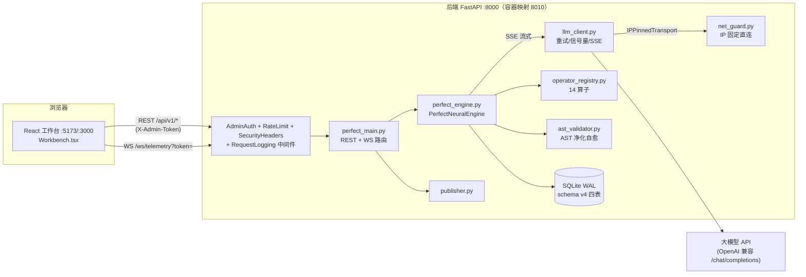
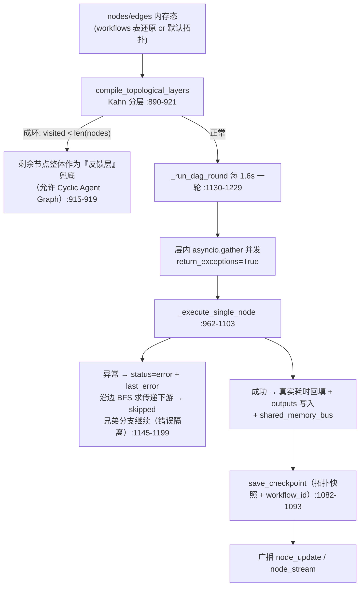
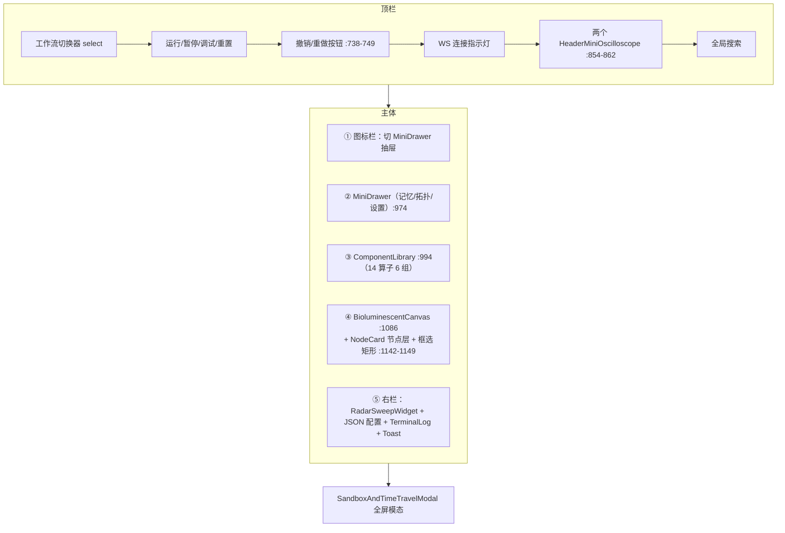
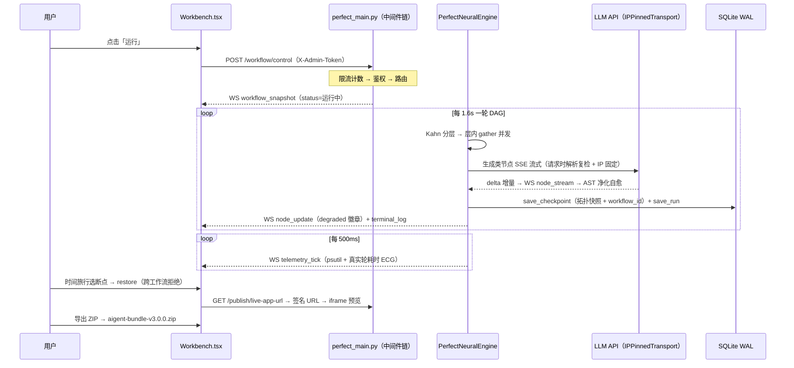

# AIGENT-WORKFLOW STUDIO v3.0 · 神经元工作流平台 — 项目源码与架构文档

> 生成日期：2026-11-07 · 对应版本：v3.0.0（backend `perfect_main.py:109` app version="3.0.0" / frontend `package.json` 3.0.0 / `models.py:85` WorkflowSnapshot.version="v3.0.0"）
> 源码范围：本仓库全部有效源码（排除 `node_modules`、`.venv`、`dist`、`.pm` 运行态），约 8600 行（不含锁文件）。
> 所有论断均标注 `文件:行号`，全部经 grep 逐条重新核实（v3.0.0 生产化改造后行号与 v2.8 时代完全不同）。

---

## 目录

1. [项目概览](#1-项目概览)
2. [目录结构总览](#2-目录结构总览)
3. [系统架构总览](#3-系统架构总览)
4. [后端架构详解（backend/）](#4-后端架构详解backend)
5. [前端架构详解（frontend/）](#5-前端架构详解frontend)
6. [测试体系](#6-测试体系)
7. [部署体系](#7-部署体系)
8. [端到端数据流：一次完整运行](#8-端到端数据流一次完整运行)
9. [安全设计汇总](#9-安全设计汇总)
10. [已知边界与遗留项](#10-已知边界与遗留项)
11. [附录：快速启动 · 行数统计 · 相关文档](#11-附录)
- [P0–P7 生产化改造总览（v2.8 → v3.0.0）](#p0p7-生产化改造总览v28--v300)

---

## 1. 项目概览

### 1.1 定位

**神经元式智能体工作流可视化平台**：以「赛博蜘蛛 HUD + 道家哲学叙事」为设计语言的可交互 AI 工作流工作台。用户在发光的神经元画布上编排算子节点、连线成 DAG（有向无环图，兼容环路）、驱动执行引擎逐层运行，实时观察遥测（CPU/内存/雷达/心电图）、节点状态、共享记忆总线与 AI 生成的 HTML 沙盒产物，并可将产物发布导出。v3.0.0 起具备多工作流管理、AI 生成节点、全局安全层（鉴权/限流/安全头/审计日志）与容器化健康检查等生产化能力。

### 1.2 技术栈

| 层 | 技术 | 版本 | 说明 |
|---|---|---|---|
| 前端框架 | React + TypeScript | 18.3 / 5.6 | 仅 3 个运行时依赖（react、react-dom、lucide-react），无状态管理/路由/图表库（`frontend/package.json` dependencies） |
| 构建工具 | Vite | 5.4 | `tsc && vite build`；生产构建无 sourcemap + 三方拆包（`frontend/vite.config.ts`） |
| 单元测试 | vitest 4 + @testing-library/react | — | jsdom 环境（`frontend/vite.config.ts` test 段） |
| E2E | Playwright | 1.65 | 双 webServer（后端 8021 + 前端 5183）（`frontend/playwright.config.ts`） |
| 后端框架 | FastAPI + Pydantic v2 | 0.162 / 2.14 | `backend/requirements.txt` |
| ASGI 服务器 | uvicorn[standard] | 0.54 | `--proxy-headers`（`backend/Dockerfile` CMD） |
| HTTP 客户端 | httpx | 0.27 | LLM 真实外呼，超时默认 60s（`backend/llm_client.py:32`） |
| 系统遥测 | psutil | 6.0 | CPU/内存真实采样（`perfect_engine.py:1255-1256`） |
| 持久化 | SQLite 3（标准库 sqlite3） | — | schema v4：checkpoints + topology + runs + workflows 四表（`perfect_engine.py:63`、`:70-130`） |
| 模糊测试 | hypothesis | ≥6 | AST 安全校验模糊测试（`backend/tests/test_ast_fuzz.py`） |
| 容器化 | Docker 多阶段 + docker-compose + nginx-unprivileged | — | 非 root + HEALTHCHECK 双服务编排（`backend/Dockerfile`、`docker-compose.yml`） |

### 1.3 版本演进（单入口结构）

| 代际 | 入口 | 状态 |
|---|---|---|
| v1 遗留 | `backend/main.py` + `backend/engine.py` | ❌ **已删除**（v3.0.0 清理，`tests/conftest.py:3` 注释「T70：v1 已删除」） |
| **v3.0.0 现役** | `backend/perfect_main.py` + `backend/perfect_engine.py` | ✅ 唯一入口 |

> 全文后端行为均指 v3.0.0 现役链路。

---

## 2. 目录结构总览

```text
E:\workflow工作台\
├── docker-compose.yml            # 双服务编排：8010:8000 后端 + 3000:8080 前端，healthcheck 门控（81 行）
├── .env.example                  # 环境变量样例（安全/网络/持久化/限流全表，约 45 行）
├── bootstrap_studio.py           # 工程脚手架/自检（96 行）
├── README.md                     # 快速启动 + 环境变量表（64 行）
├── PROJECT.md                    # pm-mcp 自动生成的项目仪表盘
├── AGENTS.md                     # pm-mcp 工作规矩（自动维护段落）
│
├── backend/                      # ── FastAPI 后端 ──────────────────────────
│   ├── perfect_main.py           # ★ 应用入口 v3.0.0（1075 行）：路由 + 4 层安全中间件
│   ├── perfect_engine.py         # ★ 执行引擎核心（1453 行）：多工作流 + SQLite schema v4
│   ├── llm_client.py             # ★ LLM 韧性层（133 行）：重试/信号量/SSE 流式
│   ├── net_guard.py              # ★ DNS rebinding 防护（110 行）：resolve_and_pin_api_base + IPPinnedTransport
│   ├── obs_logging.py            # ★ 结构化日志（105 行）：JsonFormatter + SecretFilter
│   ├── metrics.py                # ★ Prometheus 指标（94 行）：零依赖文本格式
│   ├── operator_registry.py      # 算子注册表（357 行）：real/simulated 分类 14 算子
│   ├── ast_validator.py          # HTML/AST 安全校验与自愈（209 行）
│   ├── models.py                 # Pydantic v2 数据契约（92 行）
│   ├── publisher.py              # 产物发布打包器（60 行）
│   ├── conftest.py               # pytest 垫片：自动切 .venv 解释器（26 行）
│   ├── static/vendor/            # Tailwind Play 本地化脚本（T15，脱离外部 CDN）
│   ├── requirements.txt          # 7 个运行时依赖
│   ├── requirements-dev.txt      # pytest/pytest-cov/pip-audit/hypothesis/ruff
│   ├── pytest.ini / ruff.toml    # 测试与 lint 配置
│   ├── Dockerfile                # 多阶段 + 非 root aigent + HEALTHCHECK /healthz（36 行）
│   ├── scripts/
│   │   ├── backup.py             # SQLite 在线备份（T64，默认保留 7 份）
│   │   ├── real_inference_test.py # 真实推理回归（9 组 17 断言）
│   │   └── smoke_ws.py           # WS/REST 冒烟脚本
│   └── tests/                    # ★ 35 文件 184 用例（详见 §6.1）
│
├── frontend/                     # ── React 前端 ────────────────────────────
│   ├── index.html / package.json # aigent-workflow-studio-pro v3.0.0
│   ├── vite.config.ts            # react 插件 + vitest jsdom + 生产拆包
│   ├── tsconfig.json             # strict
│   ├── playwright.config.ts      # E2E 双 webServer（8021 后端 + 5183 前端）
│   ├── e2e/                      # ★ E2E：global-setup.ts + workflow.spec.ts（4 场景）
│   ├── Dockerfile                # node:24-alpine npm ci → nginx-unprivileged:8080 + HEALTHCHECK（20 行）
│   ├── nginx.conf                # /api 反代 + /ws Upgrade + gzip + 安全头 + 资产长缓存
│   └── src/
│       ├── main.tsx              # 挂载链起点
│       ├── config.ts             # ★ API_BASE/WS_URL/令牌唯一地址来源（52 行）
│       ├── types.ts              # 前端类型契约（153 行）
│       ├── Workbench.tsx         # ★ 组合根（1277 行）：状态 + 布局 + 命令栈 + 框选
│       ├── hooks/
│       │   ├── useWorkflowSocket.ts  # WS 封装（代际锁 + 指数退避，137 行）
│       │   ├── useWorkflowApi.ts     # REST 封装（统一 adminHeaders，167 行）
│       │   ├── useSynapseLinker.ts   # Shift 连线交互（105 行）
│       │   └── usePrefersReducedMotion.ts # 系统减少动态偏好（19 行）
│       ├── components/
│       │   ├── BioluminescentCanvas.tsx   # 加色混合神经元画布（536 行）
│       │   ├── NodeMicroWidgets.tsx       # 节点微部件（319 行）
│       │   ├── SandboxAndTimeTravel.tsx   # 沙盒+AST+时间旅行模态（365 行）
│       │   ├── ComponentLibrary.tsx       # 算子组件库（136 行）
│       │   ├── NodeCard.tsx               # 节点卡片（121 行）
│       │   ├── MiniDrawer.tsx             # 迷你抽屉（209 行）
│       │   ├── HeaderMiniOscilloscope.tsx # 顶栏示波器（72 行）
│       │   ├── TerminalLog.tsx(+.test)    # 终端日志（32 行）
│       │   ├── Toast.tsx / ErrorBoundary.tsx # 全局提示 / 错误边界
│       │   └── *.test.tsx                 # vitest 测试 3 文件
│       └── utils/
│           └── layout.ts(+.test) # Kahn 分层自动布局（90 行）
│
├── scripts/                      # backup.py 部署脚本说明 + ws_smoke.py
└── test/verify-perfect-workbench.js # 结构校验脚本
```

---

## 3. 系统架构总览

### 3.1 架构图



### 3.2 进程与端口

| 场景 | 前端 | 后端 | 接线 |
|---|---|---|---|
| 本地开发 | Vite dev `:5173` | `uvicorn perfect_main:app --port 8000` | `config.ts:10-21` DEV 默认直连 `localhost:8000`，`VITE_API_BASE/VITE_WS_URL` 可覆盖 |
| E2E | Vite dev `:5183` | uvicorn `:8021`（临时库 + e2e-token） | `playwright.config.ts` webServer 注入，5183 加入 CORS/WS Origin 白名单 |
| 容器部署 | nginx-unprivileged `:3000`→8080 | 容器内 8000，宿主映射 8010 | 生产构建走同源相对路径 `/api/v1`，nginx 反代 `aigent-backend:8000`（`frontend/nginx.conf`、`config.ts:11`） |

### 3.3 通信模型

- **REST**（`/api/v1/*`）：命令式操作，写接口/敏感面需 `X-Admin-Token`（`perfect_main.py:210-213`），统一返回最新 `WorkflowSnapshot` 或操作结果。
- **WebSocket**（`/ws/telemetry`）：握手后先鉴权（Origin 白名单 4403 + token 4401，`perfect_main.py:141-160`），连接即发全量快照，此后服务端推 5 类事件（新增 `node_stream` 流式增量，`perfect_engine.py:1024-1027`）。
- **状态权威在服务端**：前端一切拓扑变更先走 `workflowApi`（`useWorkflowApi.ts`，统一附带 `adminHeaders()`），以后端返回值为准；WS 快照整体覆盖本地。

---

## 4. 后端架构详解（backend/）

### 4.1 依赖清单（requirements.txt）

```
fastapi==0.162.0   uvicorn[standard]==0.54.0   pydantic==2.14.3
starlette==1.10.0  psutil==6.0.0               httpx==0.27.2   websockets==17.4
```
开发依赖（requirements-dev.txt）：`pytest>=8,<9`、`pytest-cov>=7`、`pip-audit>=2.7`、`hypothesis>=6`、`ruff>=0.17`。

### 4.2 应用入口与启动链路（perfect_main.py）

- **应用实例**（`perfect_main.py:107-111`）：FastAPI(version="3.0.0", lifespan=lifespan)。
- **引擎单例**（`:39-43`）：`engine = PerfectNeuralEngine(ws_manager=ws_manager, persist_topology=...)`，`AIGENT_PERSIST_TOPOLOGY=1`（默认）时启动还原。
- **生命周期**（`:96-104`）：`configure_logging()`（T22 结构化日志，幂等）→ `_validate_production_env()`（`:77-93`，**AIGENT_ENV=production 时缺 AIGENT_ADMIN_TOKEN / LLM_API_BASE_ALLOWLIST 直接 RuntimeError 拒绝启动**，T62）→ `engine.start()`。
- **中间件洋葱（自外向内）**：SecurityHeaders（`:239-252`，注册于 `:327`）→ CORS（`:312-325`）→ RateLimit（`:282-305`，注册于 `:308`）→ AdminAuth（`:191-232`，注册于 `:235`）→ RequestLogging（`:331-348`，注册于 `:351`）。
- **静态服务**（`:994-996`）：`app.mount("/static", StaticFiles(...))` 托管 `static/vendor/tailwindcss-play.js`（T15 Tailwind Play 本地化，live-app 不再依赖外部 CDN）。

**AdminAuthMiddleware 全局鉴权**（`:191-232`，T10）：
- 配置 `AIGENT_ADMIN_TOKEN` 后：所有非 GET/HEAD 路由、`/api/v1/publish/*`、`/api/v1/settings/*`、`/metrics` 必须携带 `X-Admin-Token`（hmac.compare_digest 恒时比较，`:216-217`）；
- 其余 GET 是否免令牌由 `AIGENT_PUBLIC_READ=1` 决定（默认不放行，`:212-213`）——**fail-closed**；
- 未配置令牌 + 非回环来源 → 403（`:202-207`）；
- `/api/v1/publish/live-app` 与 `/export-zip` 因浏览器直开无法携带自定义头，支持 **HMAC-SHA256 短期签名 URL** 兜底（`?exp=&sig=`，`:218-225`；签发路由 `:1027-1047`）；
- `/healthz`、`/readyz` 免鉴权（`AUTH_EXEMPT_PATHS`，`:122`）。

**RateLimitMiddleware 限流**（`:282-305`，T13）：内存令牌桶（`TokenBucketLimiter :256-272`，asyncio 单线程 read-modify-write 无 await 天然原子）。写接口 60/min/IP（`AIGENT_RATE_LIMIT_PER_MIN`），严格面 `/settings`、`/ast/validate`、`/export-zip` 10/min/IP（`AIGENT_STRICT_RATE_LIMIT_PER_MIN`），超限 429 + Retry-After。

**SecurityHeadersMiddleware**（`:239-252`，T14）：nosniff / no-referrer / X-Frame-Options=DENY（live-app 豁免 XFO，`:244`）。

**RequestLoggingMiddleware**（`:331-348`，T22）：每请求生成 `X-Request-ID`（uuid4 前 12 位），写回响应头并经 contextvar 注入结构化日志。

### 4.3 REST API 全表（/api/v1）

| 方法 | 路径 | 行为 | 行号 |
|---|---|---|---|
| GET | `/api/v1/components` | 14 算子库，中英文名过滤 | `:380-385` |
| GET | `/api/v1/workflow` | 全量快照（terminal_logs 只回最近 12 条） | `:388-390` |
| GET | `/api/v1/workflows` | 列出全部工作流（不含拓扑正文） | `:399-402` |
| POST | `/api/v1/workflows` | 创建（id 1~64 字符，409 已存在） | `:405-414` |
| GET | `/api/v1/workflows/{id}` | 工作流详情（含拓扑） | `:417-422` |
| DELETE | `/api/v1/workflows/{id}` | 删除（default 不可删 400） | `:425-433` |
| POST | `/api/v1/workflows/{id}/activate` | 切换激活工作流（保存当前→载入目标→广播） | `:436-442` |
| GET | `/api/v1/workflows/{id}/export` | 导出 JSON（schema aigent-workflow v1） | `:487-511` |
| POST | `/api/v1/workflows/{id}/import` | 导入（schema/类型白名单/数量上限/环检测，失败不改拓扑） | `:514-535` |
| POST | `/api/v1/workflow/ai-suggest` | **AI 生成节点**：自然语言 → LLM 严格 JSON 增量 → 校验后应用（T34） | `:563-652` |
| POST | `/api/v1/workflow/control` | run/pause/debug/reset 四态门控 | `:655-657` |
| POST | `/api/v1/workflow/nodes` | 加节点（总数上限 413，默认 200） | `:660-668` |
| DELETE | `/api/v1/workflow/nodes/{id}` | 删节点（级联删边） | `:671-676` |
| PATCH | `/api/v1/workflow/nodes/{id}/position` | 改坐标 | `:679-688` |
| PATCH | `/api/v1/workflow/positions` | **自动布局批量落位**（单次保存+单次广播，T35） | `:701-713` |
| PUT | `/api/v1/workflow/nodes/{id}/config` | 配置热更新（64KB 上限 413） | `:716-729` |
| POST | `/api/v1/workflow/edges` | 建边（404/400 自环/409 重复/409 成环，上限 500） | `:732-760` |
| DELETE | `/api/v1/workflow/edges/{id}` | 删边 | `:792-801` |
| GET | `/api/v1/runs` | 最近 DAG 运行记录（读 SQLite runs 表，重启不丢，T26） | `:763-766` |
| GET | `/api/v1/search` | 全局检索节点/算子/日志 | `:769-789` |
| POST | `/api/v1/ast/validate` | AST 校验（512KB 上限 413），结果写 latest_sandbox_html | `:804-814` |
| GET | `/api/v1/checkpoints` | 断点列表（6 键契约） | `:817-819` |
| POST | `/api/v1/checkpoints/{id}/restore` | 回滚（跨工作流断点拒绝 409，T32 隔离） | `:822-853` |
| GET | `/api/v1/sandbox/preview` | 沙盒 HTML + 记忆总线 + Kahn 分层 | `:856-862` |
| GET/PUT | `/api/v1/settings/llm` | LLM 配置（require_admin 守卫；响应不回显 key，仅 `sk-****末4位`） | `:952-975` |
| GET | `/api/v1/publish/export-zip` | ZIP 下载（aigent-bundle-v3.0.0.zip） | `:978-990` |
| GET | `/api/v1/publish/live-app` | CSP 沙盒预览页（§4.10） | `:999-1024` |
| GET | `/api/v1/publish/live-app-url` | 签发短期签名 URL（ttl 10~3600s，默认 300） | `:1027-1047` |
| GET | `/healthz` `/readyz` `/metrics` | 存活/就绪/指标探针（免鉴权的是前两者） | `:354-377` |
| WS | `/ws/telemetry` | 遥测推送（§4.4） | `:1050-1075` |

> 体积/数量上限（T13）：`/ast/validate` code ≤512KB（`:67`）、config_json ≤64KB（`:68`）、节点 ≤200（`AIGENT_MAX_NODES`）、连线 ≤500（`AIGENT_MAX_EDGES`），超限 413/400。

### 4.4 WebSocket 协议（/ws/telemetry）

**鉴权握手**（`:1050-1057`）：先 `accept()` 完成握手再 `_authenticate_websocket`（`:141-160`）——Origin 白名单（与 CORS_ORIGINS 同源，非浏览器无 Origin 放行）失败关 4403；配置令牌后 `?token=` 或 Sec-WebSocket-Protocol 子协议校验失败关 4401（浏览器 onclose 可读自定义码）。

**首帧**：`{event:"workflow_snapshot", data:<WorkflowSnapshot>, sandbox_html}`（`:1060-1066`）。

**服务端广播**（`ConnectionManager.broadcast`，`perfect_engine.py:371-389`，死连接广播异常剔除）：

| 事件 | 频率/时机 | 载荷要点 |
|---|---|---|
| `telemetry_tick` | 每 500ms（`:1265-1276`） | project_status、cpu/memory_history（16 点 psutil 真实）、ecg_waveform（20 点，**真实 DAG 轮耗时归一化**，T27）、radar_metrics、edges；刻意不含 sandbox_html（A8 瘦身） |
| `node_update` | 每节点执行完（`:1096-1103`） | node（含 degraded 徽章）+ sandbox_html + shared_memory_bus |
| `node_stream` | **T31 新增**：LLM SSE 每段增量（`:1025-1027`） | node_id + delta（最终态仍由 node_update 携带） |
| `terminal_log` | 日志产生时（`:957-960`） | line + 最近 12 条 |
| `workflow_snapshot` | 控制/拓扑/切换变更后 | 全量快照（含 workflow_id） |

**执行循环**：`_dag_execution_loop` 每 1.6s 一轮，异常计数上报（T25）后 1s 重试（`:1231-1244`）。

### 4.5 数据模型（models.py，Pydantic v2）

| 模型 | 行号 | 语义 |
|---|---|---|
| `WorkflowStatus` | `:8-13` | 中文枚举：已就绪/运行中/已暂停/调试中/异常 |
| `ControlAction` / `ControlRequest` | `:16-25` | run/pause/debug/reset |
| `ComponentItem` | `:28-36` | id/category(+_en)/name(+_en)/icon/theme_color |
| `WorkflowNode` | `:51-64` | status ∈ idle\|active\|success\|error\|skipped；**last_error**（错误隔离留痕）+ **degraded**（T24 LLM 降级徽章，`:64`） |
| `NeuralEdge` | `:67-74` | id/source/target/latency_ms/confidence_pct/connection_status/active_pulse |
| `SystemTelemetry` | `:77-81` | cpu/memory_history + ecg_waveform + radar_metrics |
| `WorkflowSnapshot` | `:84-92` | **version="v3.0.0"**（`:85`）+ **workflow_id**（`:86`，前端切换器数据源）+ nodes/edges/telemetry/terminal_logs |

### 4.6 执行引擎（perfect_engine.py · 核心）

**核心类**：`CheckpointStore`（`:56`，SQLite 持久化）、`ConnectionManager`（`:356`）、`WorkflowState`（`:392-413`，T32 单工作流隔离状态）、`PerfectNeuralEngine`（`:416`）。

**多工作流（T32）**：引擎持 `_workflows: dict[str, WorkflowState]` 与 `active_workflow_id`（`:446-447`）；nodes/edges/shared_memory_bus/node_outputs/run_history/selected_node_id/current_run_id/latest_sandbox_html 等既有属性全部以 **property 委托**到激活工作流（`:494-585`）——存量代码零改动。`switch_workflow`（`:624-658`）：保存当前 → 载入目标（不存在时对 default 做内存态播种，T51 实证修复）→ 重置门控 → 广播快照。

**拓扑 → DAG → 执行全流程**：



**关键机制**：
- **数据沿边流动**：执行前收集上游输出 `inputs = {source: node_outputs[source]}`（`:973-977`），经算子注册表 `_inputs` 注入。
- **暂停/调试门**（`:963-967`）：入口等待 `_pause_gate` 与 `_debug_step_gate`；RESET 放行单步门防冻结（`:1376-1379`）。
- **雷达指标真实化**（`_compute_radar_metrics :1105-1128`）：由最近 50 次执行窗口统计推导（accuracy=平均置信度、responsiveness=100−平均延迟/20、stability=成功率、concurrency=最大层宽/节点数、perception=健康占比），不再随机伪造。
- **ECG 真实化（T27）**：`last_round_latency_ms`（`:454`）记录每轮 DAG 总耗时，`_telemetry_sample`（`:1246-1248`）归一化（0~1，2s 顶格）为心电数据源——**纯装饰性随机已删除**。
- **健康看护（T20/T25）**：`last_tick_monotonic` 心跳 + `loop_failure_counts`（`:460-461`）；`readiness()`（`:1285-1315`）= SQLite 可写（探针表建删）+ 双循环 task 存活（含 cancelling()>0 重建，`:1317-1327`）+ 心跳 <5s + 连续失败 <3。
- **SQLite 稳健化（T21）**：`sqlite_connect` 统一 WAL + synchronous=NORMAL + busy_timeout=5000（`:41-48`）；`SQLITE_WRITE_LOCK` 进程内写串行化（`:53`）；`_migrate` 显式幂等迁移（`:70-130`，v0→v4 每步可对旧库重复执行）。
- **并发模型**：单事件循环 asyncio；SQLite/DNS 经 `asyncio.to_thread` 下放线程池。

### 4.7 LLM 调用链路（llm_client.py，T24/T31/T12）

`LLMClient`（`llm_client.py:23`）三重韧性：

| 机制 | 细节 | 行号 |
|---|---|---|
| 重试 | 429/500/502/503/504/超时/传输错误重试，指数退避 0.5s→1s（+0~0.25s 抖动），最多 2 次；其余 4xx 与 factory 抛错为确定性失败不重试 | `:20`、`:35-38`、`:53-86` |
| 并发信号量 | `LLM_MAX_CONCURRENCY`（默认 2，对应讯飞等平台限流） | `:30-31` |
| 超时 | `LLM_TIMEOUT_S`（默认 60s） | `:32` |
| SSE 流式 | `chat_completion_stream`：stream:true，逐段 yield {delta, done, degraded, error}；**单次尝试**（增量语义下重放会重复输出），失败直接降级 | `:89-133` |
| T12 出站防护 | 每次真实尝试前经 `transport_factory` → `resolve_and_pin_api_base` 解析复检 + IP 固定直连 | `:57-58`、`:103-105` |

**消费方**：
1. `ui_generation`/`agent_codegen` 节点（有 key 时走 `chat_completion_stream`，`perfect_engine.py:993-1045`）：增量经 `node_stream` 广播；失败置 `node.degraded=True` + metrics 打点 + 日志留痕后降级内置模板（**不再静默吞掉**）。
2. `/api/v1/workflow/ai-suggest`（走 `chat_completion`，`perfect_main.py:585-596`）。
3. 真实算子 `llm_generic`（走 `chat_completion`，`operator_registry.py:159-170`）。

系统提示词固定（`perfect_engine.py:1003`）："Generate a compact Tailwind HTML card snippet…"；user 内容 = {config, inputs} 的 JSON。LLM 输出经 `FrontendASTValidator.validate_and_heal` 后写 `latest_sandbox_html`（`:1053-1054`）。

### 4.8 算子注册表（operator_registry.py）

**别名归一化**（`_ALIASES`，`:19-25`）：event_capturer→trig_events、intent_agent→agent_intent、ui_generation→agent_codegen、co_agent→logic_state、dom_renderer→fe_render；未知 type 落 `_op_default`（`:356-357`）。

**real/simulated 如实标注（T30）**（`:28`、`:108-109`、`:124-126`）：结果强制打标 `result["operator"]=normalized, result["mode"]="real"|"simulated"`，不伪装。**3 个真实算子**：

| 算子 | 行为 | 行号 |
|---|---|---|
| `llm_generic` | LLM 通用文本生成（system/user 模板，变量取自上游 `{{a.b.c}}` 点路径渲染）；无 key 返回 `skipped_no_api_key` 如实告知 | `:146-174` |
| `http_request` | 受 SSRF 防护的真实 HTTP 出站（`validate_ip_literals=True`，IP 字面量也强校验；响应体上限 max_response_bytes 默认 64KB；follow_redirects=False） | `:179-217` |
| `logic_transform` | 可配置点路径/常量/模板映射（`mappings`），**禁止 eval**；未配置 mappings 时向后兼容归一化键清单 | `:220-242` |

**11 个模拟算子**（`mode:"simulated"`）：trig_events/trig_schedule/perc_nlu/perc_vision/agent_intent/agent_codegen/logic_state/fe_assemble/fe_render/dep_test/dep_publish（`:246-354`）+ `_op_default` 兜底。组件库共 14 项（`perfect_engine.py:783-799`，新增 `llm_generic` 与 `http_request` 两个侧栏入口）。

### 4.9 沙盒执行：ast_validator.py（HTML/AST 净化与自愈）

> 定位：**HTML/AST 级净化**，不是代码执行沙箱——不 eval 生成代码、不执行 JS。

`FrontendASTValidator.validate_and_heal`（`:107-209`）流水线：剥 Markdown 围栏 → className→class 标准化 → 危险模式正则清除（`<script>`/javascript:/eval(/document.cookie，各 −25）→ 内联事件 on* 移除（每处 −10）→ 危险标签整体删除（iframe/object/embed/link/meta/base/form，各 −25）→ href/src 中 javascript:/data:text/html 清理 → 花括号配平 → `_DOMTreeAnalyzer`（HTMLParser 状态栈，`:24`）校验闭合/错位自愈并统计 DOM 深度 → 悬挂标签自动补闭合（Auto-Healing）。

**判定**：`is_valid = 无 error 且 security_score ≥ 75`（报告字段 `:15-16`）。

### 4.10 发布导出（publisher.py + live-app CSP）

**`build_project_zip`**（`publisher.py:10-60`）打 4 文件：`dist/index.html`（独立可运行 HTML）、`src/GeneratedAgentWidget.tsx`（dangerouslySetInnerHTML 内嵌沙盒）、`workflow-topology.v2.8.json`、`neural-memory-bus.json`。

**live-app 端点 CSP**（`perfect_main.py:1005-1010`，T15 本地化后收紧）：

```
Content-Security-Policy:
  sandbox allow-scripts            ← 不带 allow-same-origin：不透明源
  default-src 'none';
  script-src {base}/static/vendor/tailwindcss-play.js   ← 本地 vendor，不再放行外部 CDN 与 'unsafe-inline'
  style-src 'unsafe-inline';
  img-src data: https:
```

`/publish/live-app-url`（`:1027-1047`）为 iframe/浏览器直开签发 `?exp=&sig=` 短期签名 URL（HMAC-SHA256 + 过期时间，`:163-188`），返回绝对地址（window.open 空白 popup 中相对路径会解析到错误源）。

### 4.11 SSRF 防护与 net_guard（T12）

**前置快筛**（`perfect_main.py:878-949`）：`validate_llm_api_base(_async)` 仅 http/https + 有主机名 → `LLM_API_BASE_ALLOWLIST` 白名单 → 否则逐地址 getaddrinfo 拒绝 private/loopback/link-local/reserved/multicast（`AIGENT_ALLOW_PRIVATE_LLM=1` 放行本地 llama.cpp 等场景）；异步版 DNS 解析走线程池（`:938`）。

**请求时复检 + IP 固定**（`net_guard.py`）：设置校验与真实请求间存在 TOCTOU（DNS rebinding）。`resolve_and_pin_api_base`（`:42-79`）在**每次真实请求前**重新解析并校验全部地址，返回按首个公网 IPv4 直连的 URL；`validate_ip_literals=True` 时对 IP 字面量主机就地强校验（`:32-39`，用户自填 URL 的 http_request 算子场景必须开启；LLM 引擎路径保持 False 以兼容本地部署）。`IPPinnedTransport`（`:82-110`）把请求 URL 主机改写为已校验 IP，同时保留 Host 头与 TLS SNI（`extensions["sni_hostname"]`，`:105-107`），证书校验不受影响。

### 4.12 持久化体系（SQLite · schema v4）

**`CheckpointStore`**（`perfect_engine.py:56-353`）。路径优先级：显式参数 → `AIGENT_DB_PATH` → 工作目录默认名（`:67`）。`_migrate` 显式幂等迁移（`:70-130`），版本记录于 `schema_version` 表（`:134-141`）：

| 表 | v | 结构 | 说明 |
|---|---|---|---|
| `checkpoints` | v1/v2/v4 | checkpoint_id PK / run_id / node_id / timestamp / state_payload / generated_code / topology_json / **workflow_id** | 断点带拓扑快照与归属工作流；上限 `CHECKPOINT_MAX`（默认 2000）剪枝（`:169-176`） |
| `topology` | v1 | id=1 单行 | 旧表；启动还原时自动迁移为 workflows.default（`:701-726`） |
| `runs` | v3 | round_id PK / run_id / started_at / finished_at / status / nodes_json | **T26 运行记录持久化**：`save_run` upsert + 保留最近 50 轮（`:205-241`），重启后 `/api/v1/runs` 仍有数据 |
| `workflows` | v4 | id PK / name / nodes_json / edges_json / updated_at | **T32 多工作流表**：CRUD（`:244-304`） |

`list_checkpoints` 恒定 6 键不暴露 topology_json（`:190-201`），`get_checkpoint` 才返回完整（含 workflow_id，`:330-353`）。

### 4.13 配置体系（环境变量全表，见 .env.example）

| 变量 | 默认 | 作用 | 读取处 |
|---|---|---|---|
| `LLM_API_KEY` / `LLM_API_BASE` / `LLM_MODEL` | 空 / openai v1 / gpt-4o-mini | LLM 驱动配置（设置面板可热更新） | `perfect_engine.py:434-438` |
| `LLM_MAX_CONCURRENCY` / `LLM_TIMEOUT_S` | 2 / 60 | LLM 并发信号量 / 超时 | `llm_client.py:30-32` |
| `AIGENT_ADMIN_TOKEN` | 空（fail-closed 仅回环） | 全局管理令牌 | `perfect_main.py:125-126` |
| `AIGENT_PUBLIC_READ` | 空（GET 也需令牌） | 只读免令牌开关 | `perfect_main.py:212` |
| `AIGENT_ENV` | — | =production 时强制配置校验，缺失拒绝启动 | `perfect_main.py:79` |
| `LLM_API_BASE_ALLOWLIST` | 空 | api_base 主机白名单（生产必填） | `perfect_main.py:891` |
| `AIGENT_ALLOW_PRIVATE_LLM` | 空（拒绝） | 放行内网 api_base | `perfect_main.py:898` |
| `CORS_ORIGINS` | 本地 5173/3000 三源 | CORS 与 WS Origin 白名单 | `perfect_main.py:314-319`、`:129-138` |
| `AIGENT_RATE_LIMIT_PER_MIN` / `AIGENT_STRICT_RATE_LIMIT_PER_MIN` | 60 / 10 | 令牌桶限流 | `perfect_main.py:275-276` |
| `AIGENT_MAX_NODES` / `AIGENT_MAX_EDGES` | 200 / 500 | 拓扑容量上限 | `perfect_main.py:460-462`、`:663`、`:735` |
| `AIGENT_DB_PATH` / `AIGENT_PERSIST_TOPOLOGY` / `CHECKPOINT_MAX` | 默认库 / 1 / 2000 | 持久化 | `perfect_engine.py:60`、`:67` |
| `AIGENT_FORWARDED_ALLOW_IPS` | 127.0.0.1,::1 | uvicorn 信任的反代 IP | `backend/Dockerfile` CMD |

---

## 5. 前端架构详解（frontend/）

### 5.1 依赖与工程化

- **运行时依赖仅 3 个**：react / react-dom / lucide-react；devDependencies 含 vitest 4、@testing-library/react、@playwright/test、jsdom（`package.json`）。
- **scripts**：`dev`=vite、`build`=`tsc && vite build`、`test`=`vitest run`（`package.json` scripts）。
- **vite.config.ts**：jsdom 测试环境；生产构建 `sourcemap:false` + manualChunks 拆 react_vendor / lucide（T46）。
- **tsconfig**：strict。

### 5.2 组合根与组件树（Workbench.tsx，1277 行）

`Workbench.tsx` 是**组合根**：v3.0.0 已把 v2.8 的 1527 行单文件拆分——imports 全部来自独立模块（`:19-34`）：



**关键状态**（`Workbench.tsx`）：`workflows`/`activeWorkflowId`（`:79-80`，多工作流切换器）、`selectionSet`/`selectionRect`（`:426-427`，框选）、`undoStackRef`/`redoStackRef` + `historySize`（`:434-436`，命令栈）、`prefersReduced`（`:107`，usePrefersReducedMotion）。

### 5.3 交互实现

| 交互 | 实现 | 引用 |
|---|---|---|
| **撤销/重做（命令栈）** | `TopoCommand` 类型 + push/applyUndo/applyRedo（上限 50 条，失败回滚栈）；Ctrl+Z / Ctrl+Shift+Z 快捷键 + 顶栏按钮 | `:46`、`:443-510`、`:560-566` |
| **框选** | 画布左键空白处开始 → 拖拽更新 selectionRect → 抬起命中检测（画布坐标 = (client−rect−pan)/zoom）；Delete 键批量删除选中 | `:425-427`、`:1035-1064` |
| **缩放平移** | Ctrl+滚轮缩放 + 中键平移（view.zoom/panX/panY） | `:1001` 注释、`:1147-1149` |
| **多工作流切换器** | 顶栏 select → `POST /workflows/{id}/activate`；`workflowApi.listWorkflows/createWorkflow/activateWorkflow` | `:714-719`、`useWorkflowApi.ts:116-136` |
| **AI 生成节点入口** | T34：自然语言 → `POST /workflow/ai-suggest` → 服务端校验后刷新快照 | `:207-213` |
| **自动布局** | `computeLayeredLayout`（Kahn 分层，`utils/layout.ts`）→ `PATCH /workflow/positions` 批量落位 | `:191-197` |
| **添加/删除/连线/拖拽** | `workflowApi`（统一 adminHeaders + 可读错误 + 401 跳设置抽屉）；Shift+点击两节点经 `useSynapseLinker` 建边 | `useWorkflowApi.ts:31-167`、`:137` |
| **LLM 设置** | 抽屉打开时 GET 回填；api_key 恒空（留空=不修改）；管理令牌存 sessionStorage（键 `aigent_admin_token`） | `config.ts:23-55` |

### 5.4 WebSocket 接线（useWorkflowSocket.ts，T40 迁出）

- **代际锁保留**：模块级 `wsLoopGeneration` + `disposed` 标志终结 HMR 遗留连接（`:49-53`、`:65`）。
- **指数退避重连**：`min(15000, 1000×2^retry)`（`:110-113`），vitest 覆盖 1s/2s/4s 序列（`useWorkflowSocket.test.tsx`）。
- **地址**：`buildWsUrl()` 配置令牌时追加 `?token=`（URI 编码）（`config.ts:43-47`）。
- **订阅 5 类事件**：workflow_snapshot / telemetry_tick / node_update / **node_stream** / terminal_log（`Workbench.tsx:257-310`）。
- **REST 层**：`workflowApi` 全量封装（getSnapshot/control/addNode/deleteNode/deleteEdge/addEdge/putNodeConfig/runs/settings/workflows/aiSuggest/batchPositions 等），统一 `adminHeaders()` 与 `parseErrorDetail` 说人话报错（`useWorkflowApi.ts:7-30`）。

### 5.5 视觉动效

- **BioluminescentCanvas**（536 行，canvas 2D 加色混合）：分形树突 + 有机胞体 + 5 股贝塞尔连线彗星脉冲，单 rAF 循环；`usePrefersReducedMotion` 命中系统"减少动态"时降帧。
- **NodeMicroWidgets**（319 行）：PhosphorECGWidget（心电，数据源为真实 DAG 轮耗时）/ AuraAICoreWidget / WireframeScannerWidget / RadarSweepWidget（真实执行统计雷达）。
- **Toast**（65 行）全局提示 + **ErrorBoundary**（44 行）错误边界。

---

## 6. 测试体系

### 6.1 后端测试（35 文件 184 用例，pytest 8.4.2）

`pytest.ini`：`testpaths=tests`、`-q --tb=short`。`conftest.py` 垫片自动切 `.venv` 解释器；`tests/conftest.py:14-37` 会话级 `perfect_client` fixture（真实 lifespan + 轮询遥测填满），`_clear_rate_limit_buckets` autouse 每用例清空令牌桶。

| 分组 | 文件（用例数） | 覆盖点 |
|---|---|---|
| 鉴权 | test_auth_all_routes(7)、test_ws_auth(7)、test_settings_guard(3)、test_cors(4)、test_security_headers(3)、test_production_guard(3) | 全路由 X-Admin-Token、签名 URL、WS 4401/4403、SSRF、fail-closed、AIGENT_ENV 守卫 |
| 限流与上限 | test_limits(6) | 令牌桶 60/10、体积/数量上限 413 |
| 多工作流 | test_multi_workflow(8)、test_import_export(7)、test_batch_positions(2)、test_ai_suggest(9) | 切换/CRUD/导入导出校验链/批量落位/AI 生成校验 |
| 可靠性 | test_health(3)、test_lifecycle(3)、test_sqlite_robust(6)、test_backup_restore(2)、test_runs_persistence(4)、test_persistence(6) | /healthz /readyz、schema v4 迁移、WAL、在线备份恢复、runs 持久化 |
| 可观测 | test_logging_observability(8)、test_metrics(5)、test_telemetry_real(3) | JSON 日志/SecretFilter 脱敏、Prometheus 文本、ECG 真实化 |
| LLM | test_llm_client(8)、test_streaming(3)、test_dns_rebinding(6) | 重试/退避/信号量、SSE、resolve_and_pin + IPPinnedTransport + SNI |
| 算子 | test_real_operators(15)、test_operator_mapping(3)、test_dataflow(4)、test_error_isolation(3) | 3 真实算子、别名、数据沿边流动、错误隔离 |
| 基线回归 | test_perfect_api(9)、test_perfect_engine(9)、test_models(9)、test_topology_api(3)、test_search_endpoint(2)、test_ast_security(5)、test_ast_fuzz(3)、test_live_app_csp(3) | REST/WS 契约、Kahn、AST 安全 + hypothesis 模糊、CSP |

### 6.2 前端测试（vitest 16 用例 + Playwright E2E 4 场景）

- vitest：`config.test.ts`(4，地址/令牌/WS URL 拼接)、`useWorkflowSocket.test.tsx`(2，退避序列/卸载不重连)、`TerminalLog.test.tsx`(5，着色分类+渲染)、`layout.test.ts`(5，分层布局)。
- Playwright（`e2e/workflow.spec.ts`，双 webServer：后端 8021 临时库 + e2e-token，前端 5183 加白名单）：①主链路（加载/加节点/连线/成环被拒/运行流量）②导出 ZIP 下载 ③时间旅行回滚 ④401 登录流（错误令牌被拒 → 正确令牌放行）。

### 6.3 质量门

- **ruff clean**（`backend/ruff.toml`：line-length 110，生产代码兜底盲捕获规则集）。
- **pytest-cov**：核心模块覆盖率门槛 ≥80%（实测约 90%）。
- **pip-audit**：依赖漏洞扫描（requirements-dev.txt）。
- **真实推理回归**（`scripts/real_inference_test.py`，9 组 17 断言）与 **WS 冒烟**（`scripts/smoke_ws.py`）对真运行后端。
- **verify**：`node test/verify-perfect-workbench.js` 结构校验（字符串包含级）。

---

## 7. 部署体系

### 7.1 Dockerfile（T60 双双多阶段 + 非 root + HEALTHCHECK）

- **backend/Dockerfile**（36 行）：builder 阶段 gcc 编译依赖 → `--prefix=/install` 隔离安装 → 运行阶段仅拷依赖产物（不带 gcc）；`useradd aigent` 非 root（data 目录属主）；`ENV AIGENT_DB_PATH=/app/data/...`；**HEALTHCHECK 探 `/healthz`**（免鉴权，T20）；CMD 带 `--proxy-headers --forwarded-allow-ips "${AIGENT_FORWARDED_ALLOW_IPS:-127.0.0.1,::1}"`。
- **frontend/Dockerfile**（20 行）：`node:24-alpine` builder（**npm ci 按 lockfile 精确安装**）→ `nginxinc/nginx-unprivileged:stable-alpine`（非 root，监听 8080）；HEALTHCHECK wget 首页。
- **nginx.conf**：listen 8080；gzip；安全头（nosniff/no-referrer/XFO DENY/CSP）+ 资产长缓存 immutable + index.html no-cache；`/api/` 反代透传 X-Forwarded-For；`/ws/` Upgrade 升级反代（read_timeout 86400s）。

### 7.2 docker-compose.yml（81 行，T61）

| 服务 | 端口 | 关键配置 |
|---|---|---|
| `aigent-backend` | **8010:8000** | **命名卷 `aigent-data:/app/data`** 持久化 SQLite；healthcheck（/healthz，15s 间隔）；deploy 资源限制 memory 1g / cpus 1.5 |
| `aigent-frontend` | **3000:8080** | **depends_on condition: service_healthy**（等后端健康才启动）；静态 IP 172.28.0.3；healthcheck wget；资源限制 256m / 0.5 |

网络 `aigent-net` 固定子网 172.28.0.0/16（uvicorn forwarded-allow-ips 仅支持精确 IP，故 nginx 容器静态 IP 精确信任）。`restart: unless-stopped`。

### 7.3 运维脚本

- `backend/scripts/backup.py`：SQLite 在线 backup（不阻塞业务），默认保留 7 份到 `backend/backups`；`scripts/restore.md` 为恢复指南。
- `bootstrap_studio.py`（96 行）：建目录 + 预建表 + 核对文件存在的脚手架自检。
- **AIGENT_ENV=production 启动守卫**（`perfect_main.py:77-93`）：缺 AIGENT_ADMIN_TOKEN 或 LLM_API_BASE_ALLOWLIST 直接启动失败。

---

## 8. 端到端数据流：一次完整运行



---

## 9. 安全设计汇总

| 威胁面 | 防护 | 位置 |
|---|---|---|
| 未授权访问全部接口 | AdminAuthMiddleware fail-closed：无令牌仅回环（403），有令牌写/敏感面必带 X-Admin-Token（401）；GET 默认也需令牌 | `perfect_main.py:191-232` |
| 浏览器直开资源 | live-app/export-zip 短期签名 URL（HMAC-SHA256 + 过期） | `:163-188`、`:1027-1047` |
| WS 跨站劫持 | Origin 白名单（4403）+ token（4401），握手后鉴权浏览器可读自定义码 | `:141-160`、`:1050-1057` |
| 刷接口/大载荷 | 令牌桶 60/10 per min（429）+ 512KB/64KB/200 节点/500 边上限 | `:256-305`、`:67-68`、`:460-462` |
| 响应头滥用 | nosniff / no-referrer / XFO DENY（nginx 同步下发 + CSP） | `:239-252`、`frontend/nginx.conf` |
| LLM 生成 HTML 携带脚本 | 九步 AST 净化 score≥75 才 valid | `ast_validator.py:107-209` |
| 净化后残留脚本逃逸 | live-app CSP sandbox（无 allow-same-origin）+ script-src 仅本地 vendor Tailwind | `perfect_main.py:1005-1010` |
| DNS rebinding（TOCTOU） | 每次真实请求前解析复检 + 校验通过 IP 直连（保留 Host/SNI）；IP 字面量就地强校验 | `net_guard.py:42-110` |
| 密钥泄露 | 响应不回显 key（仅末 4 位）；日志 SecretFilter 形态抹除 + 精确值兜底 | `perfect_main.py:952-962`、`obs_logging.py:21-51` |
| 生产误配置 | AIGENT_ENV=production 缺令牌/白名单拒绝启动 | `perfect_main.py:77-93` |
| 拓扑成环 / 节点异常扩散 | 建边 DFS 409 / 导入 Kahn 400；运行期反馈层兜底 + 错误隔离 skipped | `perfect_main.py:743-744`、`perfect_engine.py:915-919`、`:1145-1199` |
| 跨工作流数据泄漏 | 断点按 workflow_id 隔离，跨工作流还原 409 | `perfect_main.py:828-834` |

---

## 10. 已知边界与遗留项

**功能性边界**（如实标注，非 bug）：
1. 11 个算子 + 兜底为内置模拟（`mode:"simulated"`）；3 个真实算子（llm_generic/http_request/logic_transform）与生成类节点需配置密钥/目标才真实执行。
2. ECG 数据源已是真实 DAG 轮耗时（T27），但首次运行前为平线；CPU/内存为 psutil 真实采样。
3. `publisher.py:51` 打包文件名仍为 `workflow-topology.v2.8.json`（仅文件名，内容为当前快照）；`operator_registry.py:350` release_tag 仍按 v2.8 前缀生成（装饰性）。
4. `perfect_main.py:108` FastAPI title 字符串仍写 "v2.8"（实际 version="3.0.0"，`:109`）——展示性残留。

**工程待办**：
- frontend `.env.local`（若存在）为联调临时覆盖；E2E 后端 8021 / 前端 5183 为测试专用端口。
- verify 脚本为字符串包含校验，非运行时验证。

---

## 11. 附录

### 11.1 快速启动

```bash
# 后端
cd backend
.venv/Scripts/python -m uvicorn perfect_main:app --port 8000

# 前端
cd frontend
npm install && npm run dev   # :5173

# 测试（pytest 184 用例 + vitest 16 + E2E 4）
cd backend && .venv/Scripts/python -m pytest -q
cd backend && .venv/Scripts/python -m pytest --cov=perfect_main --cov=perfect_engine --cov-report=term
cd frontend && npm test && npx playwright test

# lint / 审计
cd backend && ruff check .
pip-audit

# 容器部署
cp .env.example .env   # 填 AIGENT_ADMIN_TOKEN 等
docker compose up -d --build   # 前端 :3000 · 后端 :8010

# 备份
backend/.venv/Scripts/python backend/scripts/backup.py --keep 7
```

### 11.2 源码行数统计（不含 node_modules/.venv/dist/锁文件）

| 区块 | 行数 | 主要文件 |
|---|---|---|
| 后端核心 | ~3730 | perfect_engine 1453 · perfect_main 1075 · operator_registry 357 · ast_validator 209 · llm_client 133 · net_guard 110 · obs_logging 105 · models 92 · metrics 94 · publisher 60 |
| 后端测试 | ~2600 | 35 文件 184 用例 + scripts |
| 前端核心 | ~2200 | Workbench 1277 · BioluminescentCanvas 536 · SandboxAndTimeTravel 365 · NodeMicroWidgets 319 · MiniDrawer 209 · 其余组件/hooks/types |
| 前端基建 | ~400 | config/main/index.css 70 + 测试 4 文件 |
| 部署与脚手架 | ~300 | compose 81 · Dockerfile×2 56 · nginx.conf ~70 · bootstrap_studio 96 |
| **合计** | **~9200** |

### 11.3 相关文档索引

| 文档 | 内容 |
|---|---|
| `生产化执行方案.md` | P0–P7 阶段任务总表（T 编号 1~64） |
| `README.md`（根）/ `backend/README.md` | 快速启动 + 环境变量 |
| `scripts/restore.md` | SQLite 恢复指南（T64） |
| `PROJECT.md` | pm-mcp 仪表盘 |

---

## P0–P7 生产化改造总览（v2.8 → v3.0.0）

按 `生产化执行方案.md` 的阶段链路 P0→P1→P2→（关口A）→P3→P4→P5→P6→P7 完成，关键变更：

| 阶段 | 关键变更 | 主要落点 |
|---|---|---|
| **P0 基线** | 版本号统一 3.0.0；git 基线 | `perfect_main.py:109`、`models.py:85`、`package.json` |
| **P1 安全加固** | AdminAuthMiddleware（X-Admin-Token + 签名 URL + fail-closed + AIGENT_PUBLIC_READ）；RateLimitMiddleware（令牌桶 60/10）；SecurityHeadersMiddleware；WS 鉴权 4401/4403；体积/数量上限 413 | `perfect_main.py:191-305`、`:141-160` |
| **P2 可靠性与可观测** | LLMClient 重试/信号量/超时 + SSE 流式；net_guard DNS rebinding 防护；JsonFormatter + SecretFilter 结构化日志 + X-Request-ID；metrics + /metrics；/healthz /readyz + readiness 看护；SQLite WAL + 写锁 + 显式迁移 + runs 表 | `llm_client.py`、`net_guard.py`、`obs_logging.py`、`metrics.py`、`perfect_engine.py:41-53`、`:60-63`、`:205-241`、`:1285-1315` |
| **P3 核心能力** | 多工作流（WorkflowState 委托 + switch_workflow + workflows 表）；真实算子 3 个（llm_generic/http_request/logic_transform，mode 如实标注）；/ai-suggest AI 生成节点；/positions 自动布局；导入/导出 JSON；ECG 真实化（T27） | `perfect_engine.py:392-658`、`operator_registry.py:28-242`、`perfect_main.py:399-652` |
| **P4 前端工程化** | Workbench 1527 行拆为组合根 1277 行 + types.ts + 4 hooks + 8 components + utils/layout；撤销/重做命令栈、框选、缩放平移、工作流切换器、AI 生成入口、Toast/ErrorBoundary | `frontend/src/`（§5） |
| **P5 测试体系** | pytest 83→184 用例（35 文件），hypothesis 模糊测试，pytest-cov 覆盖率，vitest 16 + Playwright E2E 4 场景；**v1 遗留（main.py/engine.py/test_api/test_engine/test_websocket/test_workflow_e2e）已删除** | `backend/tests/`、`frontend/e2e/` |
| **P6 部署运维** | 双 Dockerfile 多阶段/非 root/HEALTHCHECK；compose 命名卷 aigent-data + service_healthy 门控 + 资源限制 + 8010:8000 与 3000:8080；nginx 安全头/gzip/长缓存；.env.example；scripts/backup.py + restore.md | `backend/Dockerfile`、`frontend/Dockerfile`、`docker-compose.yml` |
| **P7 收尾** | AIGENT_ENV=production 启动守卫；ruff clean；文档同步（本文档） | `perfect_main.py:77-93` |

---

*本文档由 ZCode 于 2026-11-07 基于 v3.0.0 源码逐文件分析重写；全部行号引用经 grep 逐条核实。*
